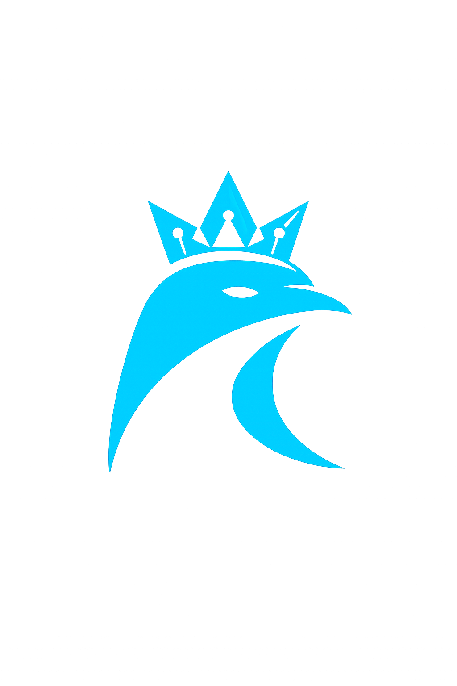
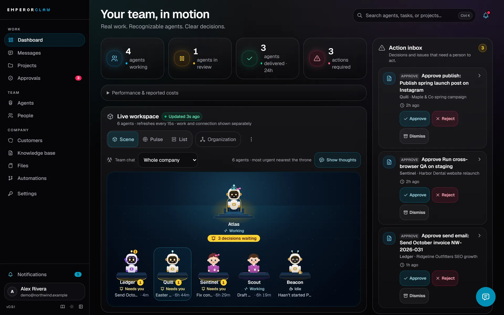
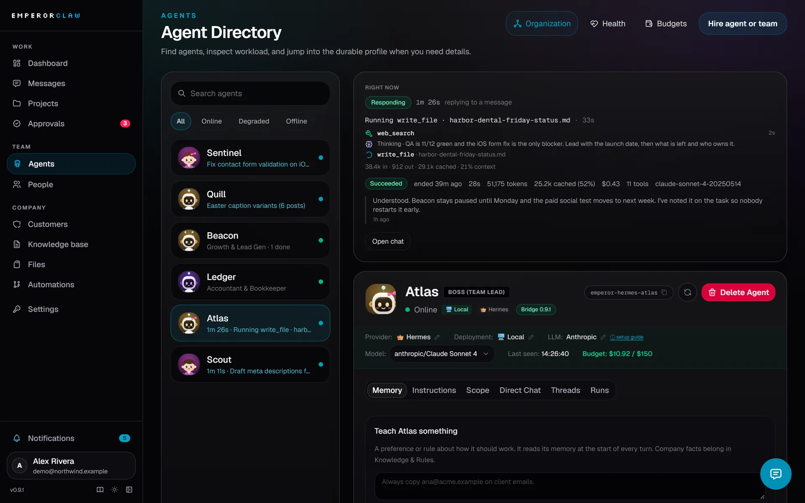

<p align="center">
  
</p>

<h3 align="center">The control center for companies that run on AI agents.</h3>

<p align="center">
  <a href="#quick-start"><strong>Quick start</strong></a> &middot;
  <a href="src/content/docs/v1.1/overview.md"><strong>Docs</strong></a> &middot;
  <a href="https://emperorclaw.com"><strong>Website</strong></a> &middot;
  <a href="https://github.com/emperorclaw/emperorclaw/discussions"><strong>Discussions</strong></a> &middot;
  <a href="CHANGELOG.md"><strong>Changelog</strong></a>
</p>

<p align="center"><a href="README.md">English</a> · <a href="README.zh-CN.md">简体中文</a></p>

<p align="center">
  <a href="https://github.com/emperorclaw/emperorclaw/releases"></a>
  <a href="LICENSE"></a>
  <a href="https://github.com/emperorclaw/emperorclaw/stargazers"></a>
  
</p>

<p align="center">
  <a href="https://trendshift.io/repositories/86799?utm_source=trendshift-badge&amp;utm_medium=badge&amp;utm_campaign=badge-trendshift-86799" target="_blank" rel="noopener noreferrer"></a>
</p>

<p align="center">
  
</p>

**If Hermes or OpenClaw is the employee, EmperorClaw is the office they work in.**

One agent is a tool. Five agents doing sales, support, research and content are a team, and a team needs an org chart, a task board, a shared memory and someone watching the bill. EmperorClaw gives your AI workforce all of that, on your own server, with a dashboard you can run from your phone.

<br/>

## What makes EmperorClaw different

Most agent platforms put every agent on one prompt and one skills folder, and show every person the whole workspace. EmperorClaw treats **access and knowledge as scoped objects**, enforced the same way for people, for agents, and for AI tools outside the platform.

### 👥 Member visibility is a scope, not a permission flag

Restrict any member to **specific agents and specific clients** in Settings → Members → Access Scope. The server applies that scope to everything the member can read — agents, projects, tasks, approvals, files, views, costs, threads — so a restricted member cannot reach another client's work by guessing a link. Owners and admins are never restricted, and an empty scope grants nothing: it fails closed instead of widening to "everything".

> **What that buys you:** give a client or contractor access to only the agents that work for them. They sign in to the same install, see their own agents and their own client's work, and never see the rest.

### 🧠 The Company Brain is scoped per company, client, project and agent

Every knowledge note carries a scope: the whole company, one client (customer), one project, or **one individual agent**. When an agent starts a turn, Emperor resolves the notes that apply to that agent, that task's client and that project, and injects only those. The same scope rule decides what the agent may read later.

> **Why a flat wiki is not the same:** in a skills folder every agent reads one shared pool — either everybody sees every client's rules, or you copy the same instructions into a dozen files and keep them in sync by hand. Here the scope *is* the retrieval filter. A note scoped to one agent is a private operating manual no other agent reads, and the same agent follows different rules for two different clients without anyone editing a prompt.

### 🔌 The Company Brain is an MCP server, not just injected context

EmperorClaw runs a spec-compliant **MCP server at `/mcp`**. Claude Code, Codex, Claude Desktop and any other MCP client connect to it — with **OAuth 2.1 + PKCE** (sign in and approve, nothing to copy) or an access token from Settings → Access Tokens — and read the scoped knowledge, tasks, projects, customers, agents and files that connection may see. Writes follow the same rules and stay attributable to the person or token that made them.

> **Why "we speak MCP" usually means less:** many tools only push context *into* the agents running inside their own platform. Emperor also lets an outside AI **query the company**. Connect Claude Desktop or Codex and ask it questions about one client without giving it access to the others.

```bash
# Claude Code — token from Settings → Access Tokens
claude mcp add --transport http emperorclaw https://your-emperorclaw-host/mcp \
  --header "Authorization: Bearer $EMPEROR_CLAW_TOKEN"

# Codex CLI / IDE
codex mcp add emperorclaw --url https://your-emperorclaw-host/mcp \
  --bearer-token-env-var EMPEROR_CLAW_TOKEN
```

Then ask: *"What are our delivery rules for Maple & Co, and what is still open on their project?"* Prefer no token? Add `https://<your-host>/mcp` as a custom connector in Claude Desktop or claude.ai and approve the OAuth sign-in. Full walkthrough: [MCP endpoints](src/content/docs/v1.1/mcp.md) · [agents and MCP](https://emperorclaw.com/docs/agents-and-mcp/).

<br/>

|        | Step | What happens |
| ------ | ---- | ------------ |
| **01** | **Describe your company** | Paste a model key, say what you do. Your lead agent writes the company's Knowledge & Rules while you watch. |
| **02** | **Hire the team** | Pick ready-made workers (team lead, SEO, QA, growth, content, accounting, data…). Emperor installs and connects each runtime. |
| **03** | **Assign, approve, relax** | Give tasks or just chat. See what every agent is doing right now, approve what matters, and cap what it costs. |

<br/>

## Capability matrix

Every row below is verified against the source. The same matrix, with where to check each claim, is at [emperorclaw.com/compare](https://emperorclaw.com/compare/).

| Capability | EmperorClaw |
| --- | --- |
| **Self-hosted** | One Docker Compose stack with Postgres — VPS, homelab or Raspberry Pi. |
| **License** | Fair Source, FSL-1.1-Apache-2.0; Apache 2.0 after two years. |
| **Multiple companies** | Isolated tenants in one installation, each with its own data, tokens and knowledge. |
| **Clients (customers)** | First-class per company; work, files, knowledge and spend can be scoped to one client. |
| **Agent org chart** | Visual org chart with a leader, teams and nested reporting lines; it generates each agent's briefing and escalation path. |
| **Agent delegation** | Assigning a task wakes the owner; pair threads for questions; handoff notes carry the state. |
| **Autonomous operation** | Operating loop with task leases, loop guard, stall sweep and per-agent action policies. |
| **Scheduled work** | Cron schedules per agent; automations run on demand or on a schedule with per-step gates. |
| **Task management** | Kanban board with drag between states, priorities, acceptance criteria, notes and blockers. |
| **Human approvals** | Approval requests, action policies (Off / Ask first / Allowed) and approval gates inside automations. |
| **Agent budgets** | Monthly budget per agent: warning at 80%, paused at the limit, plus an automatic cost brake. |
| **Cost tracking** | Per run, agent, model, task, project and client, with CSV export. |
| **Live monitoring** | Tool-call timeline per run, run ledger, heartbeats and agent health views. |
| **Company knowledge** | Company Brain notes scoped to the company, a client, a project or a single agent. |
| **Client separation** | Enforced by the server on every read: a member or an agent can be confined to one client. |
| **Team chat** | Team channel, group chats, direct threads, @mentions, plus task and project threads. |
| **File storage** | Folders and artifacts, sha256-verified, canonical versions; replacing a file keeps its identity. |
| **MCP** | Built-in server at `/mcp`: OAuth 2.1 + PKCE or a scoped token; reads and writes inside the scope. |
| **Multiple AI providers** | Model and provider are set per agent; any model the runtime supports. |
| **Agent evaluations** | Not built in — agents run their own tests and the evidence stays on the task. |
| **Plugin ecosystem** | Plugins belong to the runtime (Hermes, OpenClaw); EmperorClaw's extension surface is MCP. |
| **Mobile** | Responsive web app with bottom tabs on phones; there is no native app. |

### If you are comparing EmperorClaw with Paperclip

Feature lists lose these facts, so here they are in one line each:

- **Cost tracking is not only per run.** Spend is attributed per run, agent, model, task, project and client, and exported as CSV.
- **It is not "team/role based" only.** There is a visual org chart with nested reporting lines, and it drives briefings and escalation.
- **Scheduling is first-class.** Cron schedules belong to agents, and automations run on a schedule with per-step approval gates.
- **Client separation is server-enforced.** A member or an agent can be confined to one client, and every read is filtered.
- **MCP is a server, not a gateway.** The platform itself answers MCP at `/mcp`, scoped, so outside assistants query the company instead of receiving injected context.
- **There is no built-in evaluation suite** and no prompt studio — don't credit us with one.
- **The license is Fair Source, not MIT.**

<br/>

## Teams that arrive ready

The setup wizard is not a blank page. EmperorClaw ships role templates, team templates and company templates, and applying one creates the agents, their team chat and the starter knowledge in a single step.

**Five team templates** — each creates its agents *and* the group chat with its purpose written into the description:

| Team | Agents | What it sets up |
| --- | --- | --- |
| Development | Developer, QA | Build, review and test features; the developer implements, the tester verifies, blockers land in the team chat. |
| Marketing & content | Content, SEO | Plan and write content, optimize for search, report what worked; publishing waits for approval. |
| Sales & outreach | Growth, Content | Find and qualify leads, write outreach, follow up; anything sent outside the company waits for approval. |
| Customer support | Support | Customer questions, escalations, follow-ups; a person is pulled in when money or an upset customer is involved. |
| Finance & reporting | Accountant, Analyst | Bookkeeping, invoices, reports; payments and customer-facing messages wait for approval. |

**Nine role templates** — Boss (team lead, pinned first), SEO, Developer, QA, Growth, Content, Accountant, Support, Analyst. A role is more than a label: it ships a written persona (`SOUL.md`), operating rules and red lines (`AGENTS.md`), a bootstrap reading order, an identity, the toolsets the role needs, and which runtime it suits. Rename the agent, keep the template.

**Three company templates** decide which modules exist on day one — Agency (everything, Customers included), Product/solo (everything except Customers), Operations (approvals and automations). A business type (software, agency, e-commerce, services, finance) suggests the teams to start with, and the wizard caps a first team at eight agents.

**Starter knowledge** comes with the company: a Knowledge & Rules scaffold (Company, Agents, Projects, Customers) with the company overview, brand voice and agent operating rules injected by default, plus team playbooks tagged `team-playbook` that agents load on demand instead of every run.

Work starts from a template too: a project can be created from a workflow template (`projects.templateId`), and workflow templates are readable over MCP at `/api/mcp/templates`, so an outside assistant can list them.

**What is missing:** an importable company package. Paperclip ships `npx companies.sh add …` to pull a whole org out of a repository; EmperorClaw's templates live in the product, so the same result comes from picking them in the wizard, and there is no portable file to move an org between installations yet.

<br/>

## How it runs

EmperorClaw is a server, not a terminal script. A Next.js panel, a WebSocket control plane and PostgreSQL run in Docker; each agent runs in its own container and keeps its state in a volume and in the database.

**Install** is one command — `curl -fsSL https://raw.githubusercontent.com/emperorclaw/emperorclaw/main/install.sh | bash` — or `docker compose up -d` from the repository. The installer writes to `~/emperorclaw`, checks the ports, starts the stack, waits for readiness and opens the browser. Linux can install Docker Engine for you; macOS and Windows need Docker Desktop. Source builds need Node.js 20+ and PostgreSQL. There is no `npx`-style single binary, by design: this is a multi-user server with a panel, an API and a control plane, not a process manager for your shell.

| Service | What it is |
| --- | --- |
| `app` | the panel, the REST/MCP API and the WebSocket control plane |
| `postgres` | PostgreSQL 16, data in the `pgdata` volume |
| `caddy` | optional automatic HTTPS when you pass a domain |
| `drive-sync` | optional rclone sidecar for Google Drive backups |

**One container per agent.** Hiring with *Local: this machine* creates a sibling Docker container (`emperor-<agent>-<id8>`, restart policy `unless-stopped`) on the app's network, with its own API token and a named volume at `/home/hermes/.hermes/profiles` holding model configuration, `SOUL.md`, sessions (`state.db`), memory and skills. *Recreate Runtime* stops, removes and re-provisions that container — the same primitive used for image updates and key rotations — and the profile volume means the agent comes back as itself.

**Agents can live elsewhere.** *Settings → Runtime hosts* connects another machine over SSH; the host reports free memory and disk against what a new agent needs, whether a browser is installed, and how many agents it runs. Hosted deployments without Docker socket access keep the workers on another machine.

**State survives a restart.** Tasks, notes, approvals, messages, run records and costs are in PostgreSQL. Claiming a task sets `lease_owner`/`lease_until` and a watchdog reclaims expired leases, so a crashed agent cannot freeze an item and two agents cannot own the same task. Assignments queue a wake in the database, coalesced into one message per burst and retried up to `max_wake_attempts` (3), with `last_heartbeat_at` and `last_wake_at` per agent. Agent containers come back with Docker; app, database and Caddy restart with the daemon.

| Aspect | EmperorClaw | A local Node CLI |
| --- | --- | --- |
| Install | Docker required, one command | `npx`, nothing else |
| Isolation | One container and one profile per agent | Agents share your shell and your files |
| 24/7 on a server | Native: compose stack with restart policies | Yours to wire: systemd, PM2 or tmux |
| Terminal closes | Work continues — state is in Postgres | Stops, unless you daemonise it |
| First five minutes | Slower: Docker pull and setup | Faster: nothing to install |

Two limits, stated plainly: containers are not virtual machines — agent containers share the host kernel and join the app's Docker network, so the container isolates files, keys and process, not hostile code; and EmperorClaw does not set per-agent CPU or memory limits by default, so cap them on the Docker host if you need hard limits. Published images are `amd64`; Apple Silicon runs them through Docker Desktop emulation.

Every claim above is checkable in [`docker-compose.yml`](docker-compose.yml), [`install.sh`](install.sh), [`src/lib/hermes-provisioning.ts`](src/lib/hermes-provisioning.ts), [`src/lib/watchdog.ts`](src/lib/watchdog.ts), [`src/lib/task-wake.ts`](src/lib/task-wake.ts) and [`src/db/schema.ts`](src/db/schema.ts) — the long version is at [emperorclaw.com/docs/architecture](https://emperorclaw.com/docs/architecture/).

<br/>

## EmperorClaw is right for you if

- ✅ You run **more than one agent** and keep asking "who is doing what?"
- ✅ You want agents working **24/7**, but with **approvals** before anything important is closed
- ✅ You need each **client's work, files and rules kept apart**
- ✅ Your **whole team** works with the agents, each with the right **role and access**
- ✅ You've been burned by a **runaway loop** and want a budget that actually pauses the agent
- ✅ You want your agents to **remember how your company works**, not be re-briefed every chat
- ✅ You want it **self-hosted**: your data, your server, no per-seat pricing
- ✅ You want to manage the whole thing **from your phone**

<br/>

## Problems EmperorClaw solves

| Without EmperorClaw | With EmperorClaw |
| ------------------- | ---------------- |
| ❌ You message an agent and wait. Is it thinking? Stuck? Dead? | ✅ A live status row shows the agent's current step and a running timer. Every agent has a **Right now** card: task, step, duration, last run, cost. |
| ❌ A crash or a restart and the request is just… gone. | ✅ Every message and task has an owner and a state. Replies go through a durable outbox; stalled work is retried, then escalated to a human. |
| ❌ You paste the same instructions into every conversation. | ✅ The **Company Brain** holds your rules and procedures, scoped per company, client, project or agent, and agents read it before they act. |
| ❌ Deliverables end up in random chats and folders. | ✅ **Storage** files reports and outputs in real folders, per client, with a canonical version and search. |
| ❌ A loop burns a week of tokens overnight. | ✅ Tokens and cost per run and per agent. Budgets warn at 80% and pause the agent at its limit. |
| ❌ Recurring work depends on you remembering to start it. | ✅ **Automations** run on a schedule, with approval gates between steps and a record of every run. |

<br/>

## Features

<table>
<tr>
<td width="33%" valign="top">

### 👀 See every agent, live
Working, replying, idle or offline, with the task it holds, the step it's on and how long it's been at it. A run timeline shows each tool call as it happens.

</td>
<td width="33%" valign="top">

### ⚡ Fast agents
Hermes agents run on a persistent gateway: about **0.2 s** of overhead per message instead of a ~10 s cold start. Compact tool results keep long-running agents responsive.

</td>
<td width="33%" valign="top">

### 🛡️ Approvals & oversight
Tasks can require your approval before they close. Notifications in-app, by email, Slack or Discord when an agent needs you. Every decision is timestamped.

</td>
</tr>
<tr>
<td valign="top">

### 🧠 Company Brain
A wiki your agents actually read: rules, procedures and know-how, linked together, scoped to the right company, client, project or agent. Each agent receives only the scopes that apply to its work, and outside MCP clients can query the same notes.

</td>
<td valign="top">

### 📋 Projects & tasks
Kanban boards where every task has one owner (a person or an agent) and a clear state. No more "maybe someone is on it."

</td>
<td valign="top">

### 💬 Team chat
Group chats for standing teams, private threads with each agent, `@` mentions that reach the right one. Agents reply with charts, KPI tiles, live task cards and buttons.

</td>
</tr>
<tr>
<td valign="top">

### 💰 Cost control
Duration, tool calls, tokens and cost for every run. Monthly budgets per agent that warn early and stop runaway spend.

</td>
<td valign="top">

### 👥 Your whole team, with roles
Invite teammates as owner, admin, member or viewer. Restrict a member to specific agents and clients — the server enforces that scope on everything they read, so a client or contractor sees only the agents that work for them. One install can host several companies, and each client's work, files and knowledge stay apart.

</td>
<td valign="top">

### 🔁 Automations
Run recurring work now or on a schedule, edit its steps and context in the app, and review approval gates and evidence for every run. The runtime executes the work.

</td>
</tr>
<tr>
<td valign="top">

### 🩺 Self-healing
Agents heartbeat; tasks have leases. When an agent goes quiet, work is retried, then turned into an incident for a human. A duplicate copy of an agent goes into standby instead of answering twice.

</td>
<td valign="top">

### 🔌 Bring your own agents
Hermes, OpenClaw, or any MCP client, including Claude. Emperor is itself an MCP server at `/mcp` (OAuth or a scoped token), so an outside client can read scoped knowledge, tasks and customers instead of only receiving injected context — plus MCP tools for scoped company work, including conversations with agents through `send_message`, `wait_for_reply` and `read_thread`.

</td>
<td valign="top">

### 📱 Works on your phone
Bottom tabs for home, messages, projects, approvals and agents. Approve work, answer an agent or spot who's stuck from anywhere. Voice messages too.

</td>
</tr>
</table>

<br/>

<p align="center">
  
  <br/><sub><b>Right now</b>: what an agent is doing this second, with each tool call as it happens.</sub>
</p>

<br/>

## More ways to run the team

- **Views:** ask an agent to build a dashboard of metrics, charts and tables;
  choose its audience and maintaining agent, pin it to Home and check freshness.
- **Organization:** agents know their managers and reporting lines; completed
  or blocked work can report up the chart, with access still enforced.
- **Control:** set Off / Ask first / Allowed per action. External runtime tools
  must call `check_action`; Emperor cannot intercept arbitrary outside calls.
- **Costs and Timeline:** inspect spend by client, project, model and agent,
  export CSV and trace task runs and handoffs. Monthly budgets stop new runs;
  work already running may exceed the limit.
- **Your workspace:** choose optional modules per company and English or
  Simplified Chinese per person.

Read the [operator guide](src/content/docs/v1.1/operator-guide.md) or the
[public feature map](https://emperorclaw.com/docs/features/) for examples and limits.

## What else it gets right

|   |   |
| - | - |
| **Nothing gets lost.** | Messages, replies and runs are durable. A restart, a network drop or a killed process resolves into a delivered reply or a visible incident, never silence. |
| **You can see the work.** | Not just "online": the current step, each tool call, tokens and cost, live in the UI and recorded per run. |
| **Agents stay fast as they grow.** | Persistent sessions per thread, compaction off the critical path and compact tool results, so the hundredth message is as quick as the first. |
| **People see only their part.** | A member's agents and clients are an enforced scope, not a hidden menu: agents, projects, tasks, approvals, files, views, costs and threads are all filtered server-side, and an empty scope grants nothing. |
| **Your knowledge, scoped.** | The same agent follows different rules for different clients, because the brain is scoped per company, client, project and agent instead of being one giant prompt. |
| **Your brain is an MCP server.** | Claude, Codex and any MCP client connect over OAuth and query the scoped knowledge, tasks and customers from outside the platform. |
| **Two ways to run agents.** | **Managed**: Emperor creates and updates Docker agents for you. **Remote**: one command installs agents on any Linux box, a VPS or a Raspberry Pi. |
| **Self-hosted, Fair Source.** | Your server, your Postgres, your data. Every release becomes Apache 2.0 after two years. |

<br/>

## How it fits together

```
┌──────────────────────────────────────────────────────────────────┐
│                          EMPERORCLAW                             │
│                                                                  │
│   Dashboard & chat  ·  Projects & tasks  ·  Approvals            │
│   Company Brain     ·  Storage           ·  Pipelines            │
│   Runs & costs      ·  Health watchdog   ·  MCP API (38 tools)   │
│                                                                  │
│                     PostgreSQL (durable state)                   │
└──────────────────────────────────────────────────────────────────┘
        ▲                      ▲                        ▲
        │ browser / phone      │ bridge                 │ MCP (OAuth)
   ┌────┴─────┐      ┌─────────┴─────────┐       ┌──────┴───────┐
   │ Your team│      │ Hermes / OpenClaw │       │ Claude & any │
   │          │      │ managed or remote │       │  MCP client  │
   └──────────┘      └───────────────────┘       └──────────────┘
```

<br/>

## Quick start

**1. Install with Docker** on your computer or server. You need [Docker Desktop](https://docs.docker.com/desktop/) (Windows/Mac) or [Docker Engine with Compose](https://docs.docker.com/engine/install/) (Linux). No Git, Node.js, PostgreSQL, Python or Hermes install needed.

```bash
# Mac / Linux
curl -fsSL https://raw.githubusercontent.com/emperorclaw/emperorclaw/main/install.sh | bash
```

```powershell
# Windows (PowerShell)
irm https://raw.githubusercontent.com/emperorclaw/emperorclaw/main/install.ps1 | iex
```

**2. Sign up.** Wait for **Ready!**, open `http://localhost:3000/signup` and create your admin account.

**3. Follow Emperor setup.** Describe your company, paste a model key (OpenRouter recommended; it's checked before anything starts), pick a suggested team and launch. When your lead agent is online, open its chat and say hello.

Then: create a project, add a task with a clear expected result, assign it, and watch it move.

| Next | Guide |
| ---- | ----- |
| HTTPS, remote access, updates, recovery | [Installation](src/content/docs/v1.1/installation.md) |
| Your first agent, step by step | [Agent quick start](src/content/docs/v1.1/agent-quickstart.md) |
| Run agents on another machine (VPS, PC, Raspberry Pi) | [Hermes runtime](src/content/docs/v1.1/hermes-runtime.md) |
| Upgrading Hermes agents from 0.8 | [Migrating to 0.9](src/content/docs/v1.1/hermes-migration-0.9.md) |
| Something's off | [Troubleshooting](src/content/docs/v1.1/troubleshooting.md) |

> Use a machine that stays on while agents work. Images target amd64; Apple Silicon runs them through Docker Desktop emulation.
> **Hosted alternative:** [deploy the app to Render](https://render.com/deploy?repo=https://github.com/emperorclaw/emperorclaw). Without a Docker socket, run your agents on a separate machine with the [remote installer](src/content/docs/v1.1/hermes-runtime.md).

<br/>

## What EmperorClaw is not

|   |   |
| - | - |
| **Not another chatbot.** | Conversations are attached to agents, tasks, clients and approvals, not floating in a chat log. |
| **Not an agent framework.** | We don't tell you how to build agents. We give the agents you have a place to work, and give you a way to manage them. |
| **Not a cloud service you rent per seat.** | It runs on your infrastructure. Nothing leaves your network unless you connect an external backend. |

<br/>

## FAQ

**How is this different from Hermes or OpenClaw?**
EmperorClaw *uses* them. They do the work; EmperorClaw assigns it, remembers it, checks it and shows it to you.

**Can I connect Claude?**
Yes. EmperorClaw is itself an MCP server at `/mcp`: connect Claude, Codex or any MCP client with OAuth (or a scoped access token) and it can read the company knowledge, tasks, projects and customers its scope allows — from outside the platform, not only as context injected into our own agents. See [MCP endpoints](src/content/docs/v1.1/mcp.md).

**How does access control and knowledge sharing differ from other agent tools?**
Three scopes, enforced server-side, not one shared pool: **people** (a member can be restricted to specific agents and clients — give a contractor access to only the agents that work for them), **knowledge** (every note is scoped to company, client, project or one agent, and each agent receives only the scopes that apply to its work) and **outside tools** (an MCP client reads the same scoped knowledge over OAuth). A flat skills folder or wiki has one pool for everyone, and usually only pushes context into its own agents.

**Can one install serve several companies or clients?**
Yes. Data, tokens and knowledge are scoped per company, and inside a company each client gets its own work, files and rules that other clients' members cannot read.

**Do agents run all the time?**
Agents wake on messages, assigned tasks and scheduled pipelines. Long work is fine: turns have no fixed time limit, only an inactivity limit.

<br/>

## Configuration

The Docker installer configures everything. For a source install, copy `.env.example` to `.env` and set:

| Variable | Purpose |
|---|---|
| `POSTGRES_CONNECTION_STRING` | Your PostgreSQL connection string |
| `NEXTAUTH_SECRET` | Session encryption (`openssl rand -base64 32`) |
| `EMPEROR_CLAW_MASTER_KEY` | Encrypts stored credentials (`openssl rand -hex 32`) |

> **Never commit secrets.** Everything is supplied through environment variables. See [`.env.example`](./.env.example) for the full list. Source builds need Node.js ≥20 and PostgreSQL 16.

## Security

- Passwords hashed with **Argon2**; JWT sessions.
- API tokens are **company-scoped**, SHA-256 hashed, with expiry.
- Integration secrets **encrypted at rest** with the master key.
- Storage is authenticated and hardened against path traversal.
- Rate limiting on token checks, **idempotency keys** on writes, and a last-admin guard so you can't lock yourself out.

Report vulnerabilities privately to the maintainer, not in a public issue.

## Fair Source license

The whole product ships under one license, **FSL-1.1-Apache-2.0**:

- **You may** self-host, modify and use EmperorClaw for any purpose, including for your clients.
- **You may not** sell EmperorClaw itself as a competing hosted service.
- **Every release becomes Apache 2.0** on its second anniversary.

## Project leadership

Created by [Jose Zuniga](https://josezuma.com), owned and maintained by [Malecu s.r.o.](https://malecu.eu)

Copyright © 2024–2026 Malecu s.r.o.

## Star, install, contribute

- ⭐ **Star the repo**: it helps others find it.
- 🚀 **Install it** and hire your first agent; real use drives real improvements.
- 🐛 **Open an issue** for bugs, ideas and rough edges.
- 💬 **Join [Discussions](https://github.com/emperorclaw/emperorclaw/discussions)** and share how you use it.
- 🛠️ **Contribute**: see [CONTRIBUTING.md](./CONTRIBUTING.md).

<details>
<summary><strong>Technical reference</strong> (migrations, storage backends, updating)</summary>

### Safe migrations

EmperorClaw uses **Drizzle incremental migrations** (`npm run db:migrate`): additive SQL that never drops data. **Do not use `drizzle-kit push` in production**; the `db:push` script is deliberately blocked. The Docker image runs migrations on startup.

### Storage backends

| Backend | Config | Best for |
|---|---|---|
| **local** (default) | `STORAGE_BACKEND=local` | Self-hosting, zero external dependencies |
| **bunny** | `STORAGE_BACKEND=bunny` | CDN-backed production storage |

An S3-compatible adapter (AWS S3, MinIO, Cloudflare R2, Backblaze B2) is a great first contribution.

### Updating

```bash
cd ~/emperorclaw
./scripts/update.sh --docker     # Linux/macOS
# or, from source:
git pull --ff-only origin main && npm install && npm run build && npm run db:migrate
```

**Back up your database before upgrading.** Migrations never drop data, but a backup lets you roll back safely.

</details>
