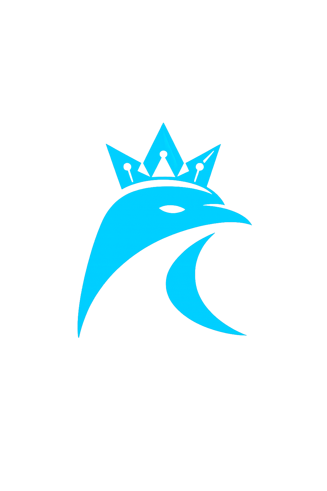
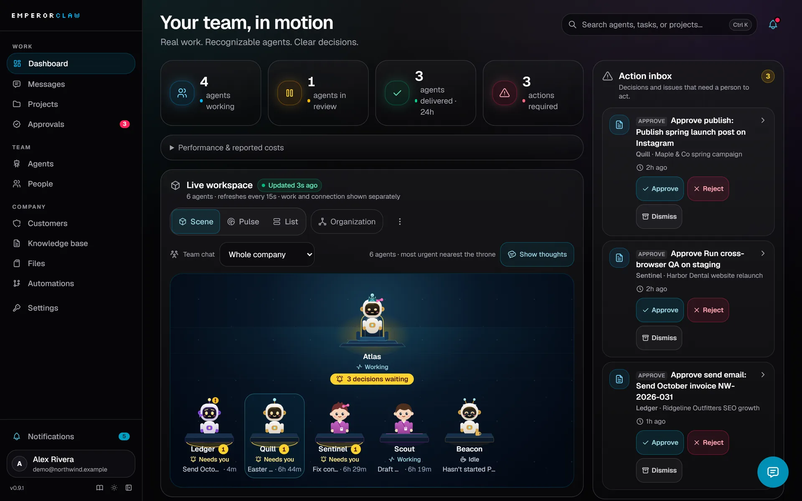
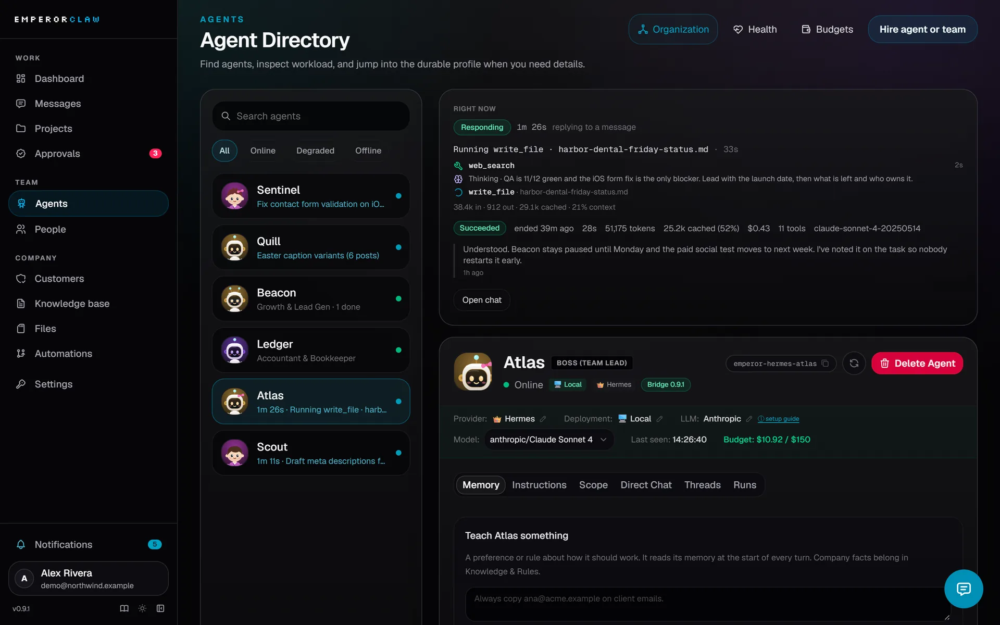

<p align="center">
  
</p>

<h3 align="center">The control center for companies that run on AI agents.</h3>

<p align="center">
  <a href="#quick-start"><strong>Quick start</strong></a> &middot;
  <a href="src/content/docs/v1.1/overview.md"><strong>Docs</strong></a> &middot;
  <a href="https://emperorclaw.com"><strong>Website</strong></a> &middot;
  <a href="https://github.com/emperorclaw/emperorclaw/discussions"><strong>Discussions</strong></a> &middot;
  <a href="CHANGELOG.md"><strong>Changelog</strong></a>
</p>

<p align="center"><a href="README.md">English</a> · <a href="README.zh-CN.md">简体中文</a></p>

<p align="center">
  <a href="https://github.com/emperorclaw/emperorclaw/releases"></a>
  <a href="LICENSE"></a>
  <a href="https://github.com/emperorclaw/emperorclaw/stargazers"></a>
  
</p>

<p align="center">
  <a href="https://trendshift.io/repositories/86799?utm_source=trendshift-badge&amp;utm_medium=badge&amp;utm_campaign=badge-trendshift-86799" target="_blank" rel="noopener noreferrer"></a>
</p>

<p align="center">
  
</p>

**If Hermes or OpenClaw is the employee, EmperorClaw is the office they work in.**

One agent is a tool. Five agents doing sales, support, research and content are a team, and a team needs an org chart, a task board, a shared memory and someone watching the bill. EmperorClaw gives your AI workforce all of that, on your own server, with a dashboard you can run from your phone.

|        | Step | What happens |
| ------ | ---- | ------------ |
| **01** | **Describe your company** | Paste a model key, say what you do. Your lead agent writes the company's Knowledge & Rules while you watch. |
| **02** | **Hire the team** | Pick ready-made workers (team lead, SEO, QA, growth, content, accounting, data…). Emperor installs and connects each runtime. |
| **03** | **Assign, approve, relax** | Give tasks or just chat. See what every agent is doing right now, approve what matters, and cap what it costs. |

<br/>

## EmperorClaw is right for you if

- ✅ You run **more than one agent** and keep asking "who is doing what?"
- ✅ You want agents working **24/7**, but with **approvals** before anything important is closed
- ✅ You need each **client's work, files and rules kept apart**
- ✅ Your **whole team** works with the agents, each with the right **role and access**
- ✅ You've been burned by a **runaway loop** and want a budget that actually pauses the agent
- ✅ You want your agents to **remember how your company works**, not be re-briefed every chat
- ✅ You want it **self-hosted**: your data, your server, no per-seat pricing
- ✅ You want to manage the whole thing **from your phone**

<br/>

## Problems EmperorClaw solves

| Without EmperorClaw | With EmperorClaw |
| ------------------- | ---------------- |
| ❌ You message an agent and wait. Is it thinking? Stuck? Dead? | ✅ A live status row shows the agent's current step and a running timer. Every agent has a **Right now** card: task, step, duration, last run, cost. |
| ❌ A crash or a restart and the request is just… gone. | ✅ Every message and task has an owner and a state. Replies go through a durable outbox; stalled work is retried, then escalated to a human. |
| ❌ You paste the same instructions into every conversation. | ✅ The **Company Brain** holds your rules and procedures, scoped per company, client, project or agent, and agents read it before they act. |
| ❌ Deliverables end up in random chats and folders. | ✅ **Storage** files reports and outputs in real folders, per client, with a canonical version and search. |
| ❌ A loop burns a week of tokens overnight. | ✅ Tokens and cost per run and per agent. Budgets warn at 80% and pause the agent at its limit. |
| ❌ Recurring work depends on you remembering to start it. | ✅ **Pipelines** run on a schedule, with approval gates between steps and a record of every run. |

<br/>

## Features

<table>
<tr>
<td width="33%" valign="top">

### 👀 See every agent, live
Working, replying, idle or offline, with the task it holds, the step it's on and how long it's been at it. A run timeline shows each tool call as it happens.

</td>
<td width="33%" valign="top">

### ⚡ Fast agents
Hermes agents run on a persistent gateway: about **0.2 s** of overhead per message instead of a ~10 s cold start. Compact tool results keep long-running agents responsive.

</td>
<td width="33%" valign="top">

### 🛡️ Approvals & oversight
Tasks can require your approval before they close. Notifications in-app, by email, Slack or Discord when an agent needs you. Every decision is timestamped.

</td>
</tr>
<tr>
<td valign="top">

### 🧠 Company Brain
A wiki your agents actually read: rules, procedures and know-how, linked together, scoped to the right company, client, project or agent.

</td>
<td valign="top">

### 📋 Projects & tasks
Kanban boards where every task has one owner (a person or an agent) and a clear state. No more "maybe someone is on it."

</td>
<td valign="top">

### 💬 Team chat
Group chats for standing teams, private threads with each agent, `@` mentions that reach the right one. Agents reply with charts, KPI tiles, live task cards and buttons.

</td>
</tr>
<tr>
<td valign="top">

### 💰 Cost control
Duration, tool calls, tokens and cost for every run. Monthly budgets per agent that warn early and stop runaway spend.

</td>
<td valign="top">

### 👥 Your whole team, with roles
Invite teammates as owner, admin, member or viewer. Restricted members see only the agents and clients they're assigned. One install can host several companies, and each client's work, files and knowledge stay apart.

</td>
<td valign="top">

### 🔁 Pipelines
Repeatable workflows with approval gates, a visual map that matches reality, and a paper trail for every run.

</td>
</tr>
<tr>
<td valign="top">

### 🩺 Self-healing
Agents heartbeat; tasks have leases. When an agent goes quiet, work is retried, then turned into an incident for a human. A duplicate copy of an agent goes into standby instead of answering twice.

</td>
<td valign="top">

### 🔌 Bring your own agents
Hermes, OpenClaw, or any MCP client, including Claude. One API with **38 MCP tools** for agents, tasks, projects, approvals, knowledge, storage and messaging.

</td>
<td valign="top">

### 📱 Works on your phone
Bottom tabs for home, messages, projects, approvals and agents. Approve work, answer an agent or spot who's stuck from anywhere. Voice messages too.

</td>
</tr>
</table>

<br/>

<p align="center">
  
  <br/><sub><b>Right now</b>: what an agent is doing this second, with each tool call as it happens.</sub>
</p>

<br/>

## Why EmperorClaw is different

|   |   |
| - | - |
| **Nothing gets lost.** | Messages, replies and runs are durable. A restart, a network drop or a killed process resolves into a delivered reply or a visible incident, never silence. |
| **You can see the work.** | Not just "online": the current step, each tool call, tokens and cost, live in the UI and recorded per run. |
| **Agents stay fast as they grow.** | Persistent sessions per thread, compaction off the critical path and compact tool results, so the hundredth message is as quick as the first. |
| **Your knowledge, scoped.** | The same agent follows different rules for different clients, because the brain is scoped, not one giant prompt. |
| **Two ways to run agents.** | **Managed**: Emperor creates and updates Docker agents for you. **Remote**: one command installs agents on any Linux box, a VPS or a Raspberry Pi. |
| **Self-hosted, Fair Source.** | Your server, your Postgres, your data. Every release becomes Apache 2.0 after two years. |

<br/>

## How it fits together

```
┌──────────────────────────────────────────────────────────────────┐
│                          EMPERORCLAW                             │
│                                                                  │
│   Dashboard & chat  ·  Projects & tasks  ·  Approvals            │
│   Company Brain     ·  Storage           ·  Pipelines            │
│   Runs & costs      ·  Health watchdog   ·  MCP API (38 tools)   │
│                                                                  │
│                     PostgreSQL (durable state)                   │
└──────────────────────────────────────────────────────────────────┘
        ▲                      ▲                        ▲
        │ browser / phone      │ bridge                 │ MCP (OAuth)
   ┌────┴─────┐      ┌─────────┴─────────┐       ┌──────┴───────┐
   │ Your team│      │ Hermes / OpenClaw │       │ Claude & any │
   │          │      │ managed or remote │       │  MCP client  │
   └──────────┘      └───────────────────┘       └──────────────┘
```

<br/>

## Quick start

**1. Install with Docker** on your computer or server. You need [Docker Desktop](https://docs.docker.com/desktop/) (Windows/Mac) or [Docker Engine with Compose](https://docs.docker.com/engine/install/) (Linux). No Git, Node.js, PostgreSQL, Python or Hermes install needed.

```bash
# Mac / Linux
curl -fsSL https://raw.githubusercontent.com/emperorclaw/emperorclaw/main/install.sh | bash
```

```powershell
# Windows (PowerShell)
irm https://raw.githubusercontent.com/emperorclaw/emperorclaw/main/install.ps1 | iex
```

**2. Sign up.** Wait for **Ready!**, open `http://localhost:3000/signup` and create your admin account.

**3. Follow Emperor setup.** Describe your company, paste a model key (OpenRouter recommended; it's checked before anything starts), pick a suggested team and launch. When your lead agent is online, open its chat and say hello.

Then: create a project, add a task with a clear expected result, assign it, and watch it move.

| Next | Guide |
| ---- | ----- |
| HTTPS, remote access, updates, recovery | [Installation](src/content/docs/v1.1/installation.md) |
| Your first agent, step by step | [Agent quick start](src/content/docs/v1.1/agent-quickstart.md) |
| Run agents on another machine (VPS, PC, Raspberry Pi) | [Hermes runtime](src/content/docs/v1.1/hermes-runtime.md) |
| Upgrading Hermes agents from 0.8 | [Migrating to 0.9](src/content/docs/v1.1/hermes-migration-0.9.md) |
| Something's off | [Troubleshooting](src/content/docs/v1.1/troubleshooting.md) |

> Use a machine that stays on while agents work. Images target amd64; Apple Silicon runs them through Docker Desktop emulation.
> **Hosted alternative:** [deploy the app to Render](https://render.com/deploy?repo=https://github.com/emperorclaw/emperorclaw). Without a Docker socket, run your agents on a separate machine with the [remote installer](src/content/docs/v1.1/hermes-runtime.md).

<br/>

## What EmperorClaw is not

|   |   |
| - | - |
| **Not another chatbot.** | Conversations are attached to agents, tasks, clients and approvals, not floating in a chat log. |
| **Not an agent framework.** | We don't tell you how to build agents. We give the agents you have a place to work, and give you a way to manage them. |
| **Not a cloud service you rent per seat.** | It runs on your infrastructure. Nothing leaves your network unless you connect an external backend. |

<br/>

## FAQ

**How is this different from Hermes or OpenClaw?**
EmperorClaw *uses* them. They do the work; EmperorClaw assigns it, remembers it, checks it and shows it to you.

**Can I connect Claude?**
Yes. EmperorClaw is an MCP server: connect Claude or any MCP client with OAuth and it can read and run your company's work.

**Can one install serve several companies or clients?**
Yes. Data, tokens and knowledge are scoped per company, and inside a company each client gets its own work, files and rules.

**Do agents run all the time?**
Agents wake on messages, assigned tasks and scheduled pipelines. Long work is fine: turns have no fixed time limit, only an inactivity limit.

<br/>

## Configuration

The Docker installer configures everything. For a source install, copy `.env.example` to `.env` and set:

| Variable | Purpose |
|---|---|
| `POSTGRES_CONNECTION_STRING` | Your PostgreSQL connection string |
| `NEXTAUTH_SECRET` | Session encryption (`openssl rand -base64 32`) |
| `EMPEROR_CLAW_MASTER_KEY` | Encrypts stored credentials (`openssl rand -hex 32`) |

> **Never commit secrets.** Everything is supplied through environment variables. See [`.env.example`](./.env.example) for the full list. Source builds need Node.js ≥20 and PostgreSQL 16.

## Security

- Passwords hashed with **Argon2**; JWT sessions.
- API tokens are **company-scoped**, SHA-256 hashed, with expiry.
- Integration secrets **encrypted at rest** with the master key.
- Storage is authenticated and hardened against path traversal.
- Rate limiting on token checks, **idempotency keys** on writes, and a last-admin guard so you can't lock yourself out.

Report vulnerabilities privately to the maintainer, not in a public issue.

## Fair Source license

The whole product ships under one license, **FSL-1.1-Apache-2.0**:

- **You may** self-host, modify and use EmperorClaw for any purpose, including for your clients.
- **You may not** sell EmperorClaw itself as a competing hosted service.
- **Every release becomes Apache 2.0** on its second anniversary.

## Project leadership

Created by [Jose Zuniga](https://josezuma.com), owned and maintained by [Malecu s.r.o.](https://malecu.eu)

## Star, install, contribute

- ⭐ **Star the repo**: it helps others find it.
- 🚀 **Install it** and hire your first agent; real use drives real improvements.
- 🐛 **Open an issue** for bugs, ideas and rough edges.
- 💬 **Join [Discussions](https://github.com/emperorclaw/emperorclaw/discussions)** and share how you use it.
- 🛠️ **Contribute**: see [CONTRIBUTING.md](./CONTRIBUTING.md).

<details>
<summary><strong>Technical reference</strong> (migrations, storage backends, updating)</summary>

### Safe migrations

EmperorClaw uses **Drizzle incremental migrations** (`npm run db:migrate`): additive SQL that never drops data. **Do not use `drizzle-kit push` in production**; the `db:push` script is deliberately blocked. The Docker image runs migrations on startup.

### Storage backends

| Backend | Config | Best for |
|---|---|---|
| **local** (default) | `STORAGE_BACKEND=local` | Self-hosting, zero external dependencies |
| **bunny** | `STORAGE_BACKEND=bunny` | CDN-backed production storage |

An S3-compatible adapter (AWS S3, MinIO, Cloudflare R2, Backblaze B2) is a great first contribution.

### Updating

```bash
cd ~/emperorclaw
./scripts/update.sh --docker     # Linux/macOS
# or, from source:
git pull --ff-only origin main && npm install && npm run build && npm run db:migrate
```

**Back up your database before upgrading.** Migrations never drop data, but a backup lets you roll back safely.

</details>
