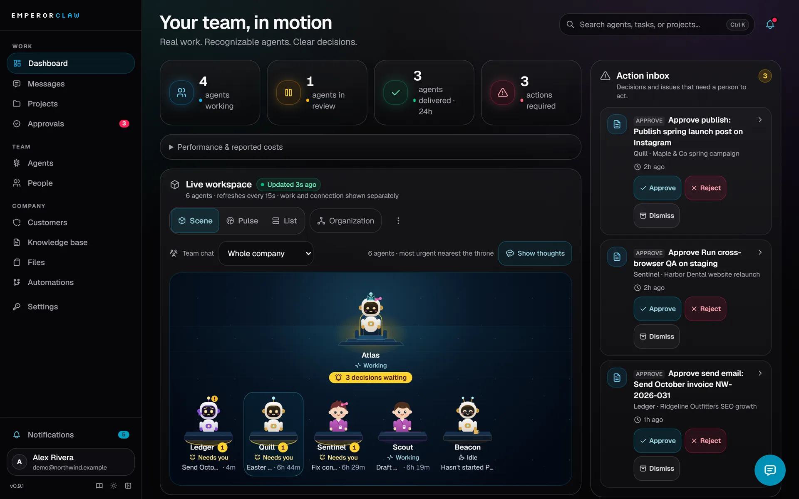
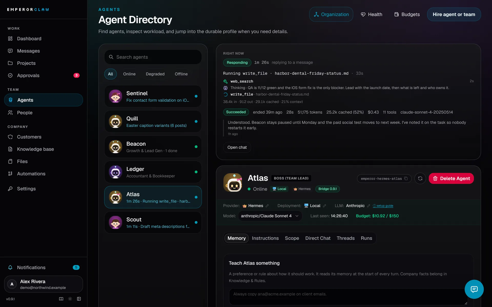

<p align="center">
  
</p>

<h3 align="center">为依靠 AI 智能体运转的公司打造的控制中心。</h3>

<p align="center">
  <a href="#快速开始"><strong>快速开始</strong></a> &middot;
  <a href="src/content/docs/v1.1/operator-guide.zh-CN.md"><strong>文档</strong></a> &middot;
  <a href="https://emperorclaw.com/zh/"><strong>官网</strong></a> &middot;
  <a href="https://github.com/emperorclaw/emperorclaw/discussions"><strong>讨论区</strong></a> &middot;
  <a href="CHANGELOG.md"><strong>更新日志</strong></a>
</p>

<p align="center"><a href="README.md">English</a> · <a href="README.zh-CN.md">简体中文</a></p>

<p align="center">
  <a href="https://github.com/emperorclaw/emperorclaw/releases"></a>
  <a href="LICENSE"></a>
  <a href="https://github.com/emperorclaw/emperorclaw/stargazers"></a>
  
</p>

<p align="center">
  <a href="https://trendshift.io/repositories/86799?utm_source=trendshift-badge&amp;utm_medium=badge&amp;utm_campaign=badge-trendshift-86799" target="_blank" rel="noopener noreferrer"></a>
</p>

<p align="center">
  
</p>

**如果说 Hermes 或 OpenClaw 是员工，那么 EmperorClaw 就是他们办公的地方。**

一个智能体只是一件工具。五个分别负责销售、客服、调研和内容的智能体就是一支团队，而团队需要组织架构、任务看板、共享记忆，还需要有人盯着账单。EmperorClaw 为你的 AI 员工提供这一切：部署在你自己的服务器上，并配有一个用手机就能管理的仪表盘。

<br/>

## EmperorClaw 有何不同

大多数智能体平台给每个智能体同一份提示词和同一个技能目录，也把整个工作空间展示给每一个人。EmperorClaw 把**权限与知识当作可被限定范围（scope）的对象**，并且对人员、对智能体、对平台之外的 AI 工具使用同一套规则。

### 👥 成员可见范围是“作用域”，而不是一个埋在权限里的开关

在 **设置 → 成员 → Access Scope（访问范围）** 里，把任何成员限定到**指定的智能体和指定的客户**。服务器会对该成员可读的一切应用这个范围——智能体、项目、任务、审批、文件、视图、成本、会话——所以被限定的成员即便猜到链接，也打不开其他客户的工作。所有者和管理员永不被限定；空范围什么也不授予（失败即拒绝，不会退化成“全部可见”）。

> **实际效果：** 只给客户或外包人员访问“为他们工作的智能体”的权限。他们登录同一套系统，只看到自己的智能体和本客户的工作，其余一概看不到。

### 🧠 Company Brain 按公司、客户、项目和单个智能体分层

每条知识笔记都带作用域：整个公司、某个客户、某个项目，或**某一个智能体**。智能体开始一轮工作时，Emperor 只解析并注入适用于该智能体、该任务所属客户与项目的笔记。同一套作用域规则也决定它之后能读到什么。

> **与扁平 wiki 的区别：** 技能目录里所有智能体读同一个共享池——要么所有人都能看到所有客户的规则，要么你得把同一份说明复制到十几个文件里手工同步。这里，作用域本身就是检索过滤器：限定到某个智能体的笔记是别人读不到的私有操作手册，同一个智能体对两个客户遵循不同的规则，而没有人需要改提示词。

### 🔌 Company Brain 本身就是一个 MCP 服务器，而不只是被注入的上下文

EmperorClaw 在 `/mcp` 运行一个符合规范的 **MCP 服务器**。Claude Code、Codex、Claude Desktop 以及任何其他 MCP 客户端都能连接——支持 **OAuth 2.1 + PKCE**（登录授权即可，无需复制令牌）或在 **设置 → Access Tokens** 生成的访问令牌——并读取该连接被允许看到的知识、任务、项目、客户、智能体和文件。写入同样遵循这些规则，并且始终可追溯到发起操作的账号或令牌。

> **为什么“支持 MCP”往往没这么多：** 很多工具只是把上下文推送给运行在自己平台内部的智能体。Emperor 还允许外部 AI **查询这家公司**：连上 Claude Desktop 或 Codex，问它某个客户的问题，而不给它其他客户的权限。

```bash
# Claude Code — 令牌在 设置 → Access Tokens 生成
claude mcp add --transport http emperorclaw https://your-emperorclaw-host/mcp \
  --header "Authorization: Bearer $EMPEROR_CLAW_TOKEN"

# Codex CLI / 编辑器扩展
codex mcp add emperorclaw --url https://your-emperorclaw-host/mcp \
  --bearer-token-env-var EMPEROR_CLAW_TOKEN
```

然后问它：*“我们对 Maple & Co 的交付规则是什么？他们的项目还有哪些没完成？”* 不想用令牌？在 Claude Desktop 或 claude.ai 里把 `https://<你的主机>/mcp` 添加为自定义连接器（custom connector），批准 OAuth 登录即可。完整说明：[MCP 端点](src/content/docs/v1.1/mcp.md) · [智能体与 MCP](https://emperorclaw.com/zh/docs/agents-and-mcp/)。

<br/>

|        | 步骤 | 会发生什么 |
| ------ | ---- | ------------ |
| **01** | **介绍你的公司** | 粘贴一个模型 key，说说你们做什么。你的主管智能体会当着你的面写出公司的 Knowledge & Rules（知识与规则）。 |
| **02** | **组建团队** | 挑选现成的员工（团队负责人、SEO、QA、增长、内容、财务、数据……）。Emperor 会安装并连接每个运行时。 |
| **03** | **分配、审批、放手** | 分配任务，或者直接聊天。随时看到每个智能体此刻在做什么，审批关键事项，并给成本设上限。 |

<br/>

## EmperorClaw 适合你，如果

- ✅ 你运行着**不止一个智能体**，却总在问"到底谁在做什么？"
- ✅ 你希望智能体 **7×24 小时**工作，但重要的事情在结束前要先经过**审批**
- ✅ 你需要让每个**客户的工作、文件和规则彼此隔离**
- ✅ 你的**整个团队**都在和智能体协作，每个人都有合适的**角色和权限**
- ✅ 你被**失控的循环**坑过，想要一个真正能让智能体停下来的预算机制
- ✅ 你希望智能体**记住公司的运作方式**，而不是每次聊天都重新交代一遍
- ✅ 你想要**自托管**：你的数据、你的服务器，不按席位收费
- ✅ 你想**用手机**管理这一切

<br/>

## EmperorClaw 解决的问题

| 没有 EmperorClaw | 有了 EmperorClaw |
| ------------------- | ---------------- |
| ❌ 给智能体发了消息，然后干等。它在思考？卡住了？还是挂了？ | ✅ 实时状态栏显示智能体当前所处的步骤和持续计时。每个智能体都有一张 **Right now**（此刻）卡片：任务、步骤、耗时、上次运行、成本。 |
| ❌ 一次崩溃或重启，请求就……凭空消失了。 | ✅ 每条消息和每个任务都有负责人和状态。回复通过持久化的 outbox 发送；停滞的工作会被重试，然后升级给人工处理。 |
| ❌ 每次对话都要把同样的指令再粘贴一遍。 | ✅ **Company Brain**（公司大脑）保存你的规则和流程，可按公司、客户、项目或智能体划分范围，智能体在行动前会先读取。 |
| ❌ 交付物散落在各种聊天和文件夹里。 | ✅ **Storage**（存储）把报告和产出按客户归档到真实的文件夹中，有唯一的正式版本，并支持搜索。 |
| ❌ 一个循环一夜之间烧掉一周的 token。 | ✅ 按每次运行、每个智能体统计 token 和成本。预算在 80% 时预警，达到上限时阻止新运行；进行中的工作可能超过预算。 |
| ❌ 周期性工作全靠你记得去启动。 | ✅ **Automations**（自动化）可立即运行或按计划启动，支持审批关卡，并保留每次运行的证据。 |

<br/>

## 功能特性

<table>
<tr>
<td width="33%" valign="top">

### 👀 实时看到每个智能体
工作中、回复中、空闲或离线，一目了然：它手上的任务、所处的步骤，以及已经忙了多久。运行时间线会实时展示每一次工具调用。

</td>
<td width="33%" valign="top">

### ⚡ 快速的智能体
Hermes 智能体运行在常驻 gateway 上：每条消息的额外开销约 **0.2 秒**，而不是约 10 秒的冷启动。精简的工具结果让长时间运行的智能体依然响应迅速。

</td>
<td width="33%" valign="top">

### 🛡️ 审批与监督
任务可以设置为必须经你审批才能关闭。当智能体需要你时，会通过应用内、邮件、Slack 或 Discord 通知你。每个决策都带有时间戳。

</td>
</tr>
<tr>
<td valign="top">

### 🧠 Company Brain
一个你的智能体真的会去读的 wiki：规则、流程和经验相互链接，并精确作用于对应的公司、客户、项目或智能体。每个智能体只收到适用于自己工作的范围，外部 MCP 客户端也能查询同一批笔记。

</td>
<td valign="top">

### 📋 项目与任务
看板中的每个任务都只有一个负责人（人或智能体）和明确的状态。不再有"应该有人在跟吧"。

</td>
<td valign="top">

### 💬 团队聊天
为固定团队准备的群聊、与每个智能体的私聊线程，以及能准确找到对应对象的 `@` 提及。智能体可以用图表、KPI 卡片、实时任务卡片和按钮来回复。

</td>
</tr>
<tr>
<td valign="top">

### 💰 成本控制
每次运行的时长、工具调用次数、token 和成本。按智能体设置月度预算，提前预警，到达上限时阻止新运行；正在进行的工作可能超限。

</td>
<td valign="top">

### 👥 全团队协作，按角色分权
以所有者、管理员、成员或访客身份邀请同事。可以把成员限定到指定的智能体和客户——服务器会对该成员可读的一切强制执行这个范围，所以客户或外包只看得到为他工作的智能体。一套部署可以承载多家公司，每个客户的工作、文件和知识都彼此隔离。

</td>
<td valign="top">

### 🔁 自动化
立即或按计划启动周期性工作，在应用中编辑步骤和上下文，并查看审批关卡与每次运行的证据。具体工作由运行时执行。

</td>
</tr>
<tr>
<td valign="top">

### 🩺 自愈能力
智能体发送心跳，任务持有租约。当某个智能体没了动静，工作会被重试，随后转为事件交给人工处理。同一智能体的重复副本会进入待机，而不是重复回答。

</td>
<td valign="top">

### 🔌 接入你自己的智能体
支持 Hermes、OpenClaw 以及任何 MCP 客户端（包括 Claude）。EmperorClaw 本身在 `/mcp` 就是一个 MCP 服务器（OAuth 或受限令牌），因此外部客户端能读取被授权的知识、任务和客户，而不只是接收被注入的上下文；另有一组 MCP 工具处理权限范围内的公司工作，并使用 `send_message`、`wait_for_reply` 和 `read_thread` 与智能体对话。

</td>
<td valign="top">

### 📱 手机上也能用
底部标签栏包含首页、消息、项目、审批和智能体。随时随地审批工作、回复智能体，或发现谁卡住了。还支持语音消息。

</td>
</tr>
</table>

<br/>

<p align="center">
  
  <br/><sub><b>Right now</b>：智能体此时此刻在做什么，每次工具调用都实时呈现。</sub>
</p>

<br/>

## 更多团队管理能力

- **视图：**让智能体创建指标、图表和表格仪表盘；选择读者与维护智能体，
  固定到首页，并检查更新时间。
- **组织架构：**智能体知道主管和汇报关系；任务完成或受阻时可以向上汇报，
  同时仍遵守访问限制。
- **操作控制：**为每类操作选择关闭、先询问或允许。外部运行时工具需要调用
  `check_action`；Emperor 无法拦截任意外部调用。
- **成本与时间线：**按客户、项目、模型和智能体分析支出，导出 CSV，并追踪
  任务运行和交接。月度预算阻止新运行，进行中的工作可能超限。
- **你的工作区：**按公司选择可选模块，每个人独立选择英文或简体中文。

阅读[团队运营指南](src/content/docs/v1.1/operator-guide.zh-CN.md)或
[中文版功能地图](https://emperorclaw.com/zh/docs/features/)，了解示例与边界。

## 其他做得好的地方

|   |   |
| - | - |
| **什么都不会丢。** | 消息、回复和运行记录都是持久化的。重启、断网或进程被杀，最终要么得到一条已送达的回复，要么出现一个可见的事件，绝不会悄无声息。 |
| **工作过程看得见。** | 不只是"在线"：当前步骤、每次工具调用、token 和成本，都在界面中实时显示，并按每次运行记录下来。 |
| **智能体越用越多，依然很快。** | 每个线程一个持久会话、压缩不占用关键路径、精简的工具结果，让第一百条消息和第一条一样快。 |
| **每个人只看到自己那一部分。** | 成员的智能体与客户范围是服务端强制的作用域，而不是藏在菜单里：智能体、项目、任务、审批、文件、视图、成本和会话都按范围过滤，空范围什么也不授予。 |
| **你的知识，按范围生效。** | 同一个智能体面对不同客户时遵循不同规则，因为大脑按公司、客户、项目和智能体分层，而不是一个巨大的 prompt。 |
| **你的大脑就是一个 MCP 服务器。** | Claude、Codex 和任何 MCP 客户端都能通过 OAuth 连接，从平台之外查询被授权的知识、任务和客户。 |
| **两种运行智能体的方式。** | **Managed（托管）**：Emperor 为你创建和更新 Docker 智能体。**Remote（远程）**：一条命令即可在任意 Linux 机器、VPS 或 Raspberry Pi 上安装智能体。 |
| **自托管，Fair Source。** | 你的服务器、你的 Postgres、你的数据。每个版本两年后都会转为 Apache 2.0。 |

<br/>

## 整体架构

```
┌──────────────────────────────────────────────────────────────────┐
│                          EMPERORCLAW                             │
│                                                                  │
│   Dashboard & chat  ·  Projects & tasks  ·  Approvals            │
│   Company Brain     ·  Storage           ·  Pipelines            │
│   Runs & costs      ·  Health watchdog   ·  MCP API              │
│                                                                  │
│                     PostgreSQL (durable state)                   │
└──────────────────────────────────────────────────────────────────┘
        ▲                      ▲                        ▲
        │ browser / phone      │ bridge                 │ MCP (OAuth)
   ┌────┴─────┐      ┌─────────┴─────────┐       ┌──────┴───────┐
   │ Your team│      │ Hermes / OpenClaw │       │ Claude & any │
   │          │      │ managed or remote │       │  MCP client  │
   └──────────┘      └───────────────────┘       └──────────────┘
```

<br/>

<a id="quick-start"></a>

## 快速开始

**1. 用 Docker 安装**到你的电脑或服务器上。你需要 [Docker Desktop](https://docs.docker.com/desktop/)（Windows/Mac）或 [Docker Engine with Compose](https://docs.docker.com/engine/install/)（Linux）。无需安装 Git、Node.js、PostgreSQL、Python 或 Hermes。

```bash
# Mac / Linux
curl -fsSL https://raw.githubusercontent.com/emperorclaw/emperorclaw/main/install.sh | bash
```

```powershell
# Windows (PowerShell)
irm https://raw.githubusercontent.com/emperorclaw/emperorclaw/main/install.ps1 | iex
```

**2. 注册。** 等待出现 **Ready!**，打开 `http://localhost:3000/signup` 并创建管理员账号。

**3. 按照 Emperor 的引导完成设置。** 介绍你的公司，粘贴一个模型 key（推荐 OpenRouter；在启动任何东西之前都会先校验），选择推荐的团队并启动。当主管智能体上线后，打开它的聊天窗口打个招呼。

接下来：创建一个项目，添加一个预期结果明确的任务，指派出去，然后看着它推进。

| 下一步 | 指南 |
| ---- | ----- |
| HTTPS、远程访问、更新、恢复 | [安装](src/content/docs/v1.1/installation.md) |
| 一步步创建你的第一个智能体 | [智能体快速开始](src/content/docs/v1.1/agent-quickstart.md) |
| 在另一台机器上运行智能体（VPS、PC、Raspberry Pi） | [Hermes 运行时](src/content/docs/v1.1/hermes-runtime.md) |
| 从 0.8 升级 Hermes 智能体 | [迁移到 0.9](src/content/docs/v1.1/hermes-migration-0.9.md) |
| 遇到问题 | [故障排查](src/content/docs/v1.1/troubleshooting.md) |

> 请使用在智能体工作期间保持开机的机器。镜像面向 amd64；Apple Silicon 可通过 Docker Desktop 的模拟运行。
> **托管替代方案：**[将应用部署到 Render](https://render.com/deploy?repo=https://github.com/emperorclaw/emperorclaw)。没有 Docker socket 时，请使用[远程安装器](src/content/docs/v1.1/hermes-runtime.md)在另一台机器上运行你的智能体。

<br/>

## EmperorClaw 不是什么

|   |   |
| - | - |
| **不是又一个聊天机器人。** | 对话挂靠在智能体、任务、客户和审批上，而不是漂浮在聊天记录里。 |
| **不是智能体框架。** | 我们不规定你如何构建智能体。我们给你现有的智能体一个工作的地方，也给你一套管理它们的方式。 |
| **不是按席位租用的云服务。** | 它运行在你的基础设施上。除非你接入外部后端，否则任何数据都不会离开你的网络。 |

<br/>

## 常见问题

**它和 Hermes 或 OpenClaw 有什么区别？**
EmperorClaw *使用*它们。它们负责干活；EmperorClaw 负责分配、记住、检查，并把结果展示给你。

**我能接入 Claude 吗？**
可以。EmperorClaw 本身在 `/mcp` 就是一个 MCP server：用 OAuth（或受限访问令牌）连接 Claude、Codex 或任何 MCP 客户端，它就能读取授权范围内的知识、任务、项目和客户——从平台外部查询，而不只是被注入到平台内部智能体的上下文里。详见 [MCP 端点](src/content/docs/v1.1/mcp.md)。

**权限控制和知识共享与其他智能体工具有什么不同？**
三层作用域，都由服务端强制执行，而不是一个共享池：**人**（成员可被限定到指定的智能体和客户——只给外包访问为他工作的智能体）、**知识**（每条笔记都限定在公司、客户、项目或单个智能体，每个智能体只收到适用于自己工作的范围）、**外部工具**（MCP 客户端通过 OAuth 读取同一批被授权的知识）。扁平的技能目录或 wiki 是全公司共用一个池子，而且通常只把上下文推给自家平台内的智能体。

**一套部署能服务多家公司或多个客户吗？**
可以。数据、token 和知识都按公司隔离；在一家公司内部，每个客户也有各自独立的工作、文件和规则，其他客户的成员读不到。

**智能体会一直运行吗？**
智能体会在收到消息、被指派任务或计划中的 pipeline 触发时被唤醒。长时间工作没有问题：单轮对话没有固定的时间上限，只有不活动超时限制。

<br/>

## 配置

Docker 安装器会自动完成所有配置。如果从源码安装，请将 `.env.example` 复制为 `.env` 并设置：

| 变量 | 用途 |
|---|---|
| `POSTGRES_CONNECTION_STRING` | 你的 PostgreSQL 连接字符串 |
| `NEXTAUTH_SECRET` | 会话加密（`openssl rand -base64 32`） |
| `EMPEROR_CLAW_MASTER_KEY` | 加密存储的凭据（`openssl rand -hex 32`） |

> **切勿提交密钥。** 所有配置都通过环境变量提供。完整列表见 [`.env.example`](./.env.example)。源码构建需要 Node.js ≥20 和 PostgreSQL 16。

## 安全

- 密码使用 **Argon2** 哈希；采用 JWT 会话。
- API token **按公司划分范围**，经 SHA-256 哈希，并带有过期时间。
- 集成密钥使用 master key **静态加密**存储。
- 存储访问需要认证，并已针对路径遍历做了加固。
- token 校验有速率限制，写操作支持**幂等键**，还有"最后一名管理员"保护，防止你把自己锁在门外。

请私下向维护者报告安全漏洞，不要发在公开 issue 中。

## Fair Source 许可证

整个产品采用同一个许可证 **FSL-1.1-Apache-2.0** 发布：

- **你可以**自托管、修改并将 EmperorClaw 用于任何目的，包括为你的客户服务。
- **你不可以**把 EmperorClaw 本身作为竞争性的托管服务出售。
- **每个版本**在发布满两周年时**都会转为 Apache 2.0**。

## 项目负责人

由 [Jose Zuniga](https://josezuma.com) 创建，由 [Malecu s.r.o.](https://malecu.eu) 拥有并维护。

版权所有 © 2024–2026 Malecu s.r.o.

## Star、安装、贡献

- ⭐ **给仓库点个 Star**：这能帮助更多人发现它。
- 🚀 **安装它**并雇佣你的第一个智能体；真实的使用才能带来真正的改进。
- 🐛 **提交 issue**，反馈 bug、想法和不顺手的地方。
- 💬 **加入 [Discussions](https://github.com/emperorclaw/emperorclaw/discussions)**，分享你的使用方式。
- 🛠️ **参与贡献**：参见 [CONTRIBUTING.md](./CONTRIBUTING.md)。

<details>
<summary><strong>技术参考</strong>（迁移、存储后端、更新）</summary>

### 安全迁移

EmperorClaw 使用 **Drizzle 增量迁移**（`npm run db:migrate`）：只做增量的 SQL，绝不删除数据。**不要在生产环境中使用 `drizzle-kit push`**；`db:push` 脚本已被刻意禁用。Docker 镜像会在启动时自动运行迁移。

### 存储后端

| 后端 | 配置 | 适用场景 |
|---|---|---|
| **local**（默认） | `STORAGE_BACKEND=local` | 自托管，零外部依赖 |
| **bunny** | `STORAGE_BACKEND=bunny` | 基于 CDN 的生产存储 |

实现一个兼容 S3 的适配器（AWS S3、MinIO、Cloudflare R2、Backblaze B2）会是非常好的第一个贡献。

### 更新

```bash
cd ~/emperorclaw
./scripts/update.sh --docker     # Linux/macOS
# 或者，从源码更新：
git pull --ff-only origin main && npm install && npm run build && npm run db:migrate
```

**升级前请先备份数据库。** 迁移绝不会删除数据，但有了备份你就能安全回滚。

</details>
