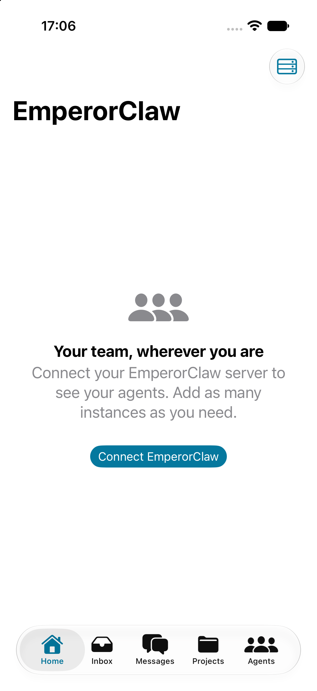

# Apple validation record — 2026-11-21

## Passed

- Installed Xcode first-launch system components successfully, resolving the DVTDownloads/IDESimulatorFoundation incompatibility.
- Full Debug build for generic iOS Simulator: EmperorPhone, embedded EmperorWatch, PhoneWidgets and WatchWidgets. Both simulator architectures compiled and linked.
- Unsigned Release build for generic physical iOS, including watchOS and both widgets. This validates compilation/packaging, not provisioning or installation on physical devices.
- Installed and launched the phone app on iPhone 17 Pro / iOS 27.2 and watch app on Series 11 42 mm / watchOS 27.2. Reviewed rendered onboarding screens. Paired the two simulators.
- Fixed missing widget CFBundleName caught by simulator installation, the watch connections button's invisible glyph and a universal orientation build warning.
- Earlier automated checks remain recorded in the app README: Swift core, SDK typechecks, temporary-PostgreSQL integration, relay/server unit tests, static suite, TypeScript and ESLint.

## Evidence

| iPhone onboarding | Watch onboarding |
| --- | --- |
|  |  |

Reproduce builds with the commands in the parent README. Existing artifacts for this development session are under `/tmp/emperor-apple-derived` (Debug simulator) and `/tmp/emperor-apple-release` (unsigned Release); these temporary files are not deliverable release binaries.

## Still required

The initial startup record was followed by an ad hoc signed simulator build and authenticated testing against the user’s HTTPS instance. OAuth consent completed, a real agent conversation loaded, and the user’s test message was acknowledged by the server. After terminating and relaunching the app, the saved connection loaded the authorized company and live fleet again without another login, verifying Keychain persistence. The unsigned build’s Keychain -34018 failure was resolved by enabling simulator signing. Physical-device testing and real APNs delivery remain pending. Xcode 27 hosts simulator interaction in `Contents/Applications/DeviceHub.app` (Device Hub), which is accessible through the visual controller. Use ad hoc signing for simulator testing: `CODE_SIGNING_ALLOWED=YES CODE_SIGN_IDENTITY=-`. An unsigned build reached the OAuth callback but failed to save credentials with Keychain error -34018; rebuilding with signing creates the required application-identifier entitlements.

Before distribution, broaden validation of refresh/revocation against a development HTTPS server; at least three installations and two companies; scoped/private chat, tasks, attachments and approval races; phone/watch credential handoff and independent selection; offline retries and deep links; APNs enrollment/delivery/token rotation; configurable widgets; accessibility, localization, screen sizes and battery/network behavior. Configure signing/App Groups/APNs, final app icons, App Store metadata and privacy disclosures. No production database, VPS or Apple distribution account was changed.
