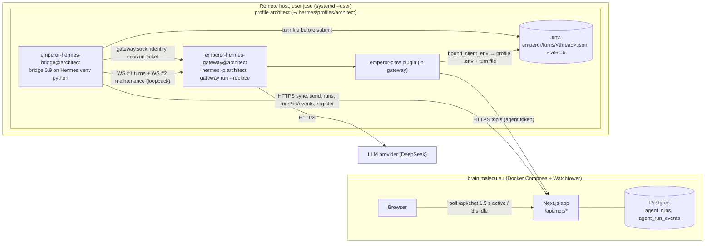
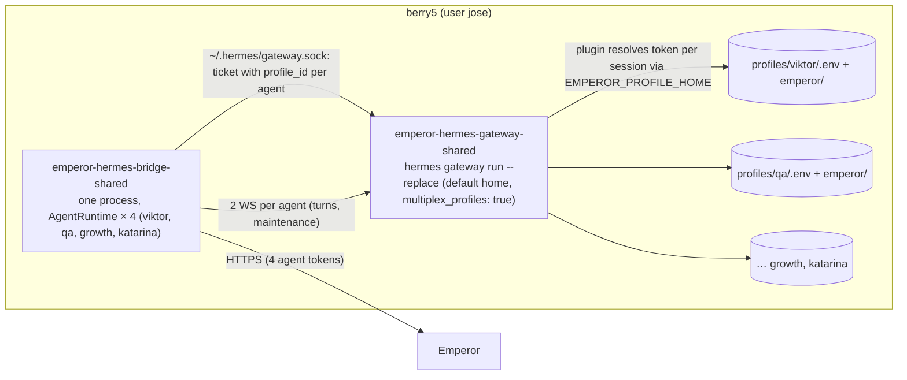
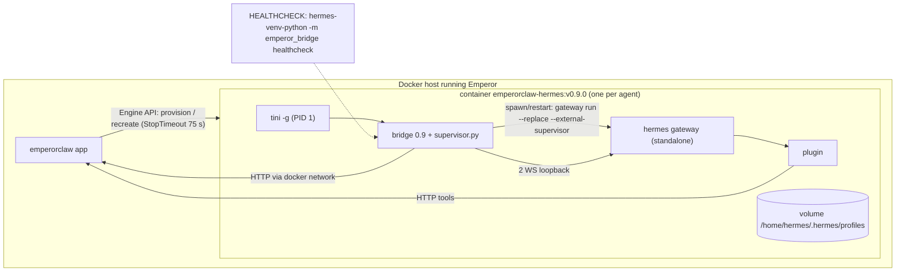

# Hermes persistent runtime (Emperor Claw 0.9.0)

Status: implementation design, **rev 2 (2026-10-22), updated with the W0 spike results**. Owner: lead architect.
Inputs (authoritative): `docs/design/hermes-server-protocol.md` (**P§n**),
`docs/design/hermes-runtime-current-state.md` (**S§n**, bridge lines as `B:n`),
`docs/design/hermes-spike-results.md` (**W0§n**), and the fixtures in `tests/fixtures/hermes-v0224/`.
Target runtime: **Hermes v0.22.4** (`4d04303818b61bf3aa09278af48356315515965b`, `identify.code_version == "0.22.4"`), pinned everywhere.

Goal: every Hermes agent stays warm. A message goes from Emperor to a running Hermes gateway over a
loopback WebSocket, live steps stream back to Emperor as structured events, and compaction happens
after the reply, not before the next one.

| Metric | Today (0.8.103, bridge 0.3.0) | 0.9.0 target | Measured in W0 (fake model) |
|---|---|---|---|
| Pickup → Hermes turn start (p50) | 9–10 s cold start | **≤ 1.5 s PC, ≤ 2.5 s Pi** (dominated by the Emperor long-poll + context fetch) | submit → `message.start` **22 ms**, connect 3.7 ms, gateway overhead per turn ~0.2 s |
| First message after a long session | +30–80 s blocking compaction | 0 s. Compaction runs after the reply | compress runs on its own socket. A submit queues behind it |
| Live status source | `agent.log` regex, `state.db` polling | Hermes events | `tool.start/complete` with `duration_s`, `reasoning.delta`, `session.usage` confirmed |
| Usage | log scraping | `prompt.receipt.result` | cache/reasoning/api_calls/model/provider in `result` |
| Stop | process-group kill | `session.interrupt` | **210 ms** streaming, **367 ms** provider hung |
| WiFi drop mid-turn | turn killed, DM cancelled (~28 %/week on PC) | turn continues. Reply and events parked and delivered later | — |

### Rev 2 change log (what the spike changed)

| Area | Rev 1 | Rev 2 |
|---|---|---|
| D2 topology | standalone only | standalone by default. **Opt-in shared host gateway** for low-memory hosts (new D21). Fleet: Pi uses shared |
| D6 context | full dynamic block in `api_text` | `api_text` is **persisted and replayed** → small delta only. Everything static goes in the system prompt. The plugin `pre_llm_call` hook is **deleted** |
| D4 sessions | request_id only | exact `session.create` params stored per generation and replayed byte-identically |
| D9/D13 | one socket | **two sockets**: `turns` and `maintenance`. Compress only on `maintenance`, only while idle |
| D15 | generic | SIGTERM → `interrupted`. SIGKILL → `unknown` + paused FIFO → `prompt.resolve_unknown` |
| D16 | receipt.usage | ledger fields from **`prompt.receipt.result`**. `receipt.usage` has only input/output/total |
| D17 | `~/.hermes/hermes-agent/venv` | venv at `~/.hermes/installs/*/environments/*/venv` (Python 3.14.7, websockets 15.0.1), resolved by the installer into a stable symlink |
| D8 plugin credentials | `os.environ` | per-session profile `.env` read through `bound_client_env()` (works in both topologies) |
| §9 harness | new `tests/hermes-contract/` | **W8 adopts `tests/contract/hermes/` in place** |

---

## 1. Decisions

Verdict column: **C** = confirmed by W0, **R** = replaced or refined by W0, **N** = new in rev 2, **O** = still open (gate named).

| # | Topic | Decision | Verdict / evidence |
|---|---|---|---|
| D1 | Transport | Gateway WebSocket JSON-RPC (`hermes-gateway-v1`) only. The CLI path is deleted. The bridge refuses to start unless `identify` gives `kind == "hermes-gateway"`, `state == "ready"`, `runtime_protocol == 1`, `"session-authority-v1" in capabilities`, and `code_version == "0.22.4"` (pin check, no git needed). | **C** (W0§6 D1, D20). `hermes chat -q --source tool` still works but adds nothing. |
| D2 | Gateway topology | **Default: one standalone gateway per profile** (`gateway.standalone: true`). **Opt-in, for low-memory hosts only: one shared host gateway** (`EMPEROR_CLAW_HERMES_GATEWAY=shared`), see D21. Managed Docker is always standalone (one container = one agent). | **R**. Standalone confirmed (W0 finding 4: `os.environ` is shared across sessions in one process, so isolation by process is real). Memory forced the opt-in: 225 MiB idle, **297 MiB warm** per gateway (S-11). |
| D3 | Process layout | Mode A standalone: two user units per profile (`emperor-hermes-gateway@<p>`, `emperor-hermes-bridge@<p>`). Mode A shared: `emperor-hermes-gateway-shared` + one `emperor-hermes-bridge-shared` hosting all profiles on the host (§5.1 multi-agent). Mode B: `tini` → bridge → gateway child (`supervisor.py`). Gateway settings: **`agent.restart_drain_timeout: 45`**, stop timeout 60 s, and **`SuccessExitStatus=1`** because the gateway exits rc 1 on SIGTERM. | **R** (W0§6 D3). The 45 s drain is below the stop timeout. Whether drain lets a turn finish on a plain stop is untested, so the contract test `graceful_stop_drain` decides (§9). If not, turns settle `interrupted` (D15). |
| D4 | Session mapping | One session per (agent, thread, generation). `request_id = "emperor/<agentId>/<threadId>/g<generation>"`, `source:"tool"`. **The full `session.create` params are stored per generation (`threads[t].createParams`) and replayed byte-identically.** `policyHash = sha256(canonical JSON of createParams)[:16]`. A policy change means a new generation, never a changed replay. | **R** (W0 finding 8: any changed frozen field → `invalid_params` "a resumed request_id must carry the same frozen request"). Slashes in request_id work. |
| D5 | Turn idempotency | `submission_id = "emp-<triggerMessageId>"` (coalesced: last id, retry: `-r<n>`). Run id = `uuid5(NS_EMPEROR_RUN, submission_id)`. Reply `Idempotency-Key` = submission_id. | **C**. Exact resubmit returns the same `admission_id`. Changed text returns `admission_conflict`. |
| D6 | Context placement | **System prompt** (`client_env.HERMES_EPHEMERAL_SYSTEM_PROMPT`, frozen per session) = identity, instructions, operating guide, reply-format guide, roster, doctrine, **and the stable per-thread context** (thread title/type, participants, group/team roles, org chart). **`api_text`** = a delta of **≤ 400 chars** plus the human message: `[emperor msg=<id8> from=<name> (<human|agent>) at=<HH:MM UTC>]`, a changed-task line only when the open-task set changed since the last turn in this session (≤ 3 lines), and `[ack-first]` only for human senders. **`text`** = the human message. The plugin `pre_llm_call` hook is **removed** (D22). Open tasks and the main-chat digest are no longer pushed. The agent fetches them with tools (`emperor_list_tasks`, `emperor_get_thread`) when it needs them. | **R** (W0 finding 2: `api_text` is stored as `api_content` and replayed every turn. Finding 3: the hook output is appended to every user message). The static-block refresh throttle is unchanged (≤ 1 new generation per 6 h per thread, except identity/instructions edits). |
| D7 | Plugin turn context | `threadId/threadType/sessionGen/agentId/profileHome` from `bound_client_env()` (`EMPEROR_THREAD_ID`, `EMPEROR_THREAD_TYPE`, `EMPEROR_SESSION_GEN`, `EMPEROR_AGENT_ID`, `EMPEROR_PROFILE_HOME`, listed in `terminal.client_env_passthrough`). `messageId/runId` from the turn file `<profileHome>/emperor/turns/<threadId>.json`, written before submit. **Never** read `os.environ` for per-session data. If the session id is ever needed, use `gateway.session_context.get_session_env("HERMES_SESSION_ID")` (logical id, stable across compress). | **C** (S-18, S-5). Names must not start with `HERMES_` and must not look secret (`*_TOKEN`, `*_KEY` are dropped). |
| D8 | Credentials | Each profile `.env` holds `EMPEROR_CLAW_API_URL/TOKEN/AGENT_ID/AGENT_NAME`, the provider key and `MCP_EMPERORCLAW_API_KEY`. **Plugin:** resolves credentials **per session** by reading `<EMPEROR_PROFILE_HOME>/.env` (cached by mtime). `os.environ` is only the fallback for non-Emperor sessions. An Emperor token rotation takes effect on the next tool call with no restart. **Model key:** re-read only at `session.create` (S-8), so rotation = restart the gateway, or bump the generation of the affected threads. **Bridge:** reads each profile's `.env` itself (no `EnvironmentFile`), which lets one bridge process host several agents (D21). | **R** (S-8: plugin env is frozen until restart, but `.env` wins at boot). Per-session file resolution is required for the shared gateway and harmless in standalone. |
| D9 | Concurrency | Bridge-side per-thread FIFO, ≤ 1 in-flight admission per session, parallel cap per agent `EMPEROR_CLAW_HERMES_MAX_PARALLEL_TURNS` (default 3. Pi 1. Builder and LeadExtractor 1: shared working dirs). Coalescing as rev 1. `steer` opt-in, **untested** (contract test `steer_followup` before enabling). **Two WebSockets per gateway connection set: `turns` (create/resume/submit/interrupt/receipt/config) and `maintenance` (compress, `events.since` bulk replay).** Liveness uses `gateway.ping` (bypasses the queue), never the `ping` RPC. | **R** (W0 finding 6: RPCs on one socket are serial. A 3 s compress blocked a submit for 2.1 s on the same socket, 7 ms on a second socket). |
| D10 | Interrupt | Stop → `session.interrupt {session_id, execution_generation}`, with `execution_generation` **taken from `message.start`**. `stale_generation` → re-read with `prompt.receipt` and treat the turn as already settled. Outcome mapping: `message.complete{outcome:"cancelled", status:"interrupted"}` and receipt `outcome:"interrupted"` both mean run `cancelled`. | **C**, refined (W0§6 D10). |
| D11 | Approvals / clarify | `yolo:true` at create. `clarify.request` → auto `clarify.respond` within 1 s (**untested**: contract test `clarify_auto`). `approval.request` → `approval.respond once`. Profile `approvals.timeout: 60` as a backstop: without yolo the command is blocked and the turn still completes (S-7). | **C** (S-7, S-16). `finite/unattended` work but are not needed. |
| D12 | Reasoning | `config.set show_reasoning on` after **every** create, resume and gateway restart (it is lost on restart, values read back as `"0"/"1"`). Forward `reasoning.delta` (coalesced 1.5 s). Ignore `reasoning.available` when deltas were seen in the turn. Use it as one `reasoning` event when none were seen. `thinking.delta` is spinner text: not forwarded. | **C** (S-6, fixtures `reasoning_turn`, `normal_turn`). |
| D13 | Compaction | After the reply is delivered: if `session.usage.payload.usage.context_used ≥ EMPEROR_CLAW_HERMES_COMPACT_AFTER_TOKENS` (60000) **and the session has no in-flight admission**, send on the **maintenance** socket `session.mutate {session_id, request_id:"compress-<uuid4>", expected_revision, expected_generation, operation:"compress", payload:{partial:true, keep_last:6}}`, timeout 660 s. `session_busy` → retry after the next settle, at most 3 times. The bridge does **not** hold its thread queue: a submit during compress queues inside Hermes and runs right after (S-17). The turn file is still exact, because compress is not an admission. | **R** (S-17: compress while a turn runs → `4001 session_busy`. `expected_generation` is required). Real duration at 60k tokens is still unmeasured (**O**: canary gate). |
| D14 | Reconnect / replay | `identify` first. **Same `instance_id`:** new ticket → WS → `session.resume` → `session.events.since {last_sequence, replay_epoch}` (gapless from `last_sequence+1`, includes `message.complete`). **Changed `instance_id` / `authority_epoch` (gateway restarted):** restart path (D15). `snapshot_required:true` → `prompt.receipt` per waiting admission. Events can arrive before the RPC result that caused them: buffer by `admission_id`. WS refusals are **HTTP 403 on the upgrade** (not close 4403): treat them as "re-identify + new ticket", with backoff 0.2 → 5 s. Ignore unknown event types (`sessions.changed`, `platforms.changed`, `session.updated`). | **C**, refined (fixture `reconnect_replay`, W0§7). |
| D15 | Restart-lost turns | On the restart path, for every admission in `state.turns` not delivered: `session.resume`, re-set `show_reasoning`, `prompt.receipt {include_result:true}`. `terminal` + `interrupted` (SIGTERM, `turn_exit_reason` contains `gateway_shutdown`) or receipt `unknown` (SIGKILL: no `message.complete`, **FIFO paused**) → for `unknown` first send `prompt.resolve_unknown {session_id, admission_id, execution_generation}` (it becomes `interrupted` and unpauses the FIFO). Then: **auto-retry once (`-r1`) only if the bridge's own persisted `turns[].sawTool` is false.** Otherwise post the restart notice and finish the run `failed` with `runtime_restart`. Queued admissions inside Hermes run by themselves after a restart. The bridge does not resubmit them (only compress-queued submits can exist there). | **R** (W0 finding 9, fixture `gateway_kill9_mid_turn`). The replay ring is gone after a restart, so `sawTool` is persisted at the first `tool.start`. |
| D16 | Usage / cost | Ledger from **`prompt.receipt.result`**: `input_tokens, output_tokens, cache_read_tokens, cache_write_tokens, reasoning_tokens, api_calls, model, provider, cost_status, estimated_cost_usd, turn_exit_reason, failure_reason`. `costCents = round(estimated_cost_usd*100)` only when `cost_status ∉ {"unknown", null}`. Otherwise null and the server prices tokens. Live `usage` events from `session.usage.payload.usage` (`input, output, reasoning, calls, context_used, context_max, context_percent`). `report-usage` is kept, fed from `result`. | **R** (W0§6 D16: `receipt.usage` = `{input_tokens, output_tokens, total_tokens}` only). DeepSeek cost presence is **O** (S-10: canary gate, harmless if absent). |
| D17 | Bridge runtime | The bridge runs on **Hermes' managed venv interpreter**. The installer/Docker build resolves it once, `ls -d ~/.hermes/installs/*/environments/*/venv/bin/python` filtered to the one whose `import hermes_cli` resolves inside the target checkout, and links it to a stable path: **`~/.local/share/emperor-hermes/python`** (Mode A) / **`/home/hermes/.local/bin/hermes-venv-python`** (Mode B). `HERMES_PYTHON` overrides it. It is re-resolved on every `emperor-hermes update`, because install ids and env hashes change. The goal adapter gets `PYTHONPATH=<checkout>`, `cwd=<checkout>`. CI runs the bridge on **Python 3.14**. | **R** (S-15: Python 3.14.7, websockets 15.0.1. `~/.hermes/hermes-agent/venv` does not exist). |
| D18 | Objectives | Objective turns go through `TurnRunner` (ledger `triggerKind: objective`). The adapter keeps `start/status/clear` (working on logical sessions). **`evaluate`:** W4 fixes the stdin payload path and must pass contract test `goal_evaluate`. If it is not green by the W4 exit, evaluation switches to a hidden turn (`display_kind:"hidden"`, `api_text` asks for `{"done":bool,"next":str}`) and the adapter's `evaluate` is deleted. | **O** (S-13: `evaluate` raised `JSONDecodeError` reading stdin). Gate: W4 acceptance. |
| D19 | One runtime per agent | Unchanged (register `duplicateRuntime` → standby). | Not a Hermes question. |
| D20 | Versioning | Unchanged. The bridge reports `hermesVersion = identify.code_version`, `hermesCodeSha = identify.code_sha`. | **C**. |
| D21 | Low-memory hosts | See §1.1. | **N** |
| D22 | Plugin hook | The `pre_llm_call` registration is deleted. The operating guide stays available to humans as the plugin **skill** (`register_skill`). | **N** (W0 finding 3: 15 kB per message, truncated and replayed). |

### 1.1 D21: topology for low-memory hosts (owner constraint: Pi 4 GB, ~300 MB free)

The numbers: a gateway is 225 MiB idle and **~300 MiB warm** (S-11, x86_64. aarch64 is expected to be similar or smaller and gets measured in R-1 below). A bridge 0.9 process is estimated at 40–50 MiB (measured in R-1). Four standalone agents on the Pi = ~1.4 GiB, which does not fit.

| Option | Memory (4 agents) | Isolation | Verdict |
|---|---|---|---|
| A. Standalone per agent | ~4 × 300 + 4 × 45 ≈ 1.4 GiB | full process isolation | **Default for hosts that fit the budget** (PC, Docker) |
| B. **Shared host gateway + one multi-agent bridge** (opt-in) | ~300 + (n−1) × Δ (Δ measured in R-1, expected ≤ 40 MiB) + ~60 MiB ≈ **0.4–0.5 GiB** | same UID and same process. Credentials resolved per session from each profile's `.env` (D8). A crash or restart hits every agent on the host | **Chosen for the Pi** if R-1 passes |
| C. Move the Pi's agents to the PC | 0 on the Pi, +1.4 GiB on the PC | full | **Fallback** if R-1 fails. Also the long-term option if the PC has headroom. Concentrates every agent behind the PC's flaky WiFi, which bridge 0.9 tolerates but not gracefully for turns that need Emperor tools during a drop |
| D. Bound the count (≤ k standalone on the Pi, rest moved) | k × 345 MiB | full | Rejected as the primary: it still moves agents and gains little over C |

**Rule enforced by the installer** (`emperor-hermes doctor --plan`): measure `MemAvailable` with the legacy bridges stopped. Let `need_standalone = n × 345 MiB` and `need_shared = 300 + (n−1) × Δ + 60 MiB`, with reserve 512 MiB. If `need_standalone ≤ MemAvailable − reserve`, use standalone. Else if `need_shared ≤ MemAvailable − reserve`, propose `--gateway shared`, which requires the operator's explicit flag. Else refuse and print the agents to move.

**The credential trade-off of shared mode**, stated in the docs and in the installer prompt:
1. Every agent on the host runs in one process. A bug that reads `os.environ` (W0 finding 4) or a malicious tool could use another agent's Emperor token. Actions would then be attributed to the wrong agent, which is an audit problem within one company.
2. On a single-UID host the files are already mutually readable, so the *new* exposure is in-process only.
3. One gateway crash, restart or model-key rotation interrupts every agent on the host. Restarts use `emperor-hermes restart-gateway --when-idle`.

**Shared mode is therefore allowed only when** all profiles on the host belong to one Emperor company, under one operator, on one OS user. Bridge 0.9 checks that the `agentId`s registered from a shared host share a `companyId` (register returns `sharedHostOk`). If they do not, it refuses to dispatch.

**R-1 spike (blocking for Pi rollout, owner of execution: W7 with senior review), run on the Pi itself:**
1. RSS of a shared gateway serving 4 profiles, warm after 20 turns per profile (gate: ≤ 450 MiB). RSS of one multi-agent bridge.
2. A profile added after start is served after `hermes gateway rescan` (or a restart). Record which.
3. A ticket minted on the **default home's** `gateway.sock` with `profile_id=<agent home>` (P§1.3 shape B) creates sessions under that profile.
4. Credential correctness: two profiles with different `.env` tokens run parallel turns that call `emperor_health`. Each request reaches `emperor_echo` with **its own** bearer (plugin per-session resolution).
5. Per-profile model `key_env` is used per session.
6. A standalone RSS on aarch64 for the record.

Fail on 3–5 → option C. Fail on 1 only → option C, or keep at most `floor((MemAvailable−512)/345)` standalone agents on the Pi and move the rest.

---

## 2. Architecture

### 2.1 Mode A, standalone (PC, and any host that fits the budget)



### 2.2 Mode A, shared (opt-in low-memory host: the Pi)



### 2.3 Mode B, managed Docker



### 2.4 One message, end to end

```mermaid
sequenceDiagram
  participant E as Emperor API
  participant B as Bridge
  participant F as turn file
  participant G as Gateway (WS turns)
  participant M as Gateway (WS maintenance)
  participant P as Plugin
  E->>B: sync returns message M (thread T)
  B->>G: session.create (stored createParams for T/g3; cached, idempotent)
  B->>G: config.set show_reasoning on (once per attach/restart)
  B->>F: write turns/T.json {messageId M, runId, submissionId emp-M}
  B->>G: prompt.submit {submission_id emp-M, text, api_text = delta + message, turn_author}
  G-->>B: message.start (keep execution_generation) → turn.started
  G-->>B: tool.generating / tool.start / tool.complete / reasoning.delta / session.usage / agent.print
  B-->>E: events batched every 500 ms
  G->>P: emperor_send_message(acknowledge) → bound_client_env + T.json → replyToMessageId=M
  G-->>B: message.complete {admission_id, outcome completed}
  B->>G: prompt.receipt {include_result true} → result.* usage
  B->>E: reply (Idempotency-Key emp-M), PATCH run
  B->>F: delete turns/T.json
  B->>M: session.mutate compress (only if context_used ≥ 60k and T idle)
```

---

## 3. Spike status (W0 done) and remaining checks

W0 answered every rev-1 spike (W0§3). Summary of the effect on this design:

| ID | Result | Effect |
|---|---|---|
| S-1 | `profile_id` = absolute profile home | Default kept |
| S-2 | Standalone starts with or without a default gateway | `multiplex_profiles: false` on the default profile **dropped** (it would break D21 shared mode) |
| S-3 | `emperor` rows: resume `not_found`, import `invalid_params` | Fresh sessions + continuity seed |
| S-4 | n/a | — |
| S-5 | `get_session_env` gives the logical id, stable across compress | D7 |
| S-6 | `show_reasoning` lost on restart | D12 |
| S-7 | Approval times out after `approvals.timeout` (300 s default), command blocked | D11 + `approvals.timeout: 60` |
| S-8 | Plugin env frozen until restart. Model key re-read at create | D8 per-session `.env` read |
| S-9 | Scopes `profile`/`host` | Omit `scope` (standalone). Shared: R-1 item 3 |
| S-10 | Custom provider: no cost | **Open**, canary gate |
| S-11 | 225 MiB idle, ~297 MiB warm | D21 |
| S-12 | `api_text` replayed | D6 delta-only |
| S-13 | `evaluate` failed | D18 **open**, W4 gate |
| S-14 | Side-by-side install works (`install.sh --dir`, launcher `<dir>/.hermes/bin/hermes`, `~/.local/bin/hermes` untouched) | Runbook §10 uses it for **per-profile cutover with no host downtime** |
| S-15 | venv path / Python 3.14.7 / websockets 15.0.1 | D17 |
| S-16 | finite/unattended work | Not used |
| S-17 | compress 3.1 s (fake). Submit during compress queues. Compress while running → `session_busy` | D13 |
| S-18 | `bound_client_env()` works, per session, survives restart | D7 |
| S-19 | Plugin API unchanged. Hook output goes into the user message | D22 |
| S-20 | 9 fixtures recorded | §4.3, W3 unit tests |

Still open. Each one is owned by a stream and closed by a test or a canary gate, never by assumption:

| ID | Question | Closed by |
|---|---|---|
| R-1 | Shared gateway on the Pi (§1.1) | W7, before the Pi rollout |
| R-2 | `clarify` auto-answer flow | contract test `clarify_auto` (W8) |
| R-3 | `session.steer` behavior | contract test `steer_followup` (W8). `steer` stays opt-in |
| R-4 | `agent.restart_drain_timeout` lets a running turn finish on SIGTERM | contract test `graceful_stop_drain` (W8) |
| R-5 | Real compress duration at 60k tokens, DeepSeek cost fields | canary metrics (§10.2) |
| R-6 | Goal adapter `evaluate` | W4 acceptance (D18) |
| R-7 | `session.create` RTT outlier (526 ms p50 in one run) | not on the hot path (create is cached). Watch `ensure_session` in the timing logs |

---

## 4. Server / API changes (W1, W2)

### 4.1 Migration `0061_agent-run-events.sql` (additive only)

```sql
CREATE TABLE "agent_run_events" (
  "id" uuid PRIMARY KEY,                         -- uuid5(run_id, "<replay_epoch>:<hermes seq>") or uuid4 for bridge-made events
  "company_id" uuid NOT NULL REFERENCES "companies"("id") ON DELETE CASCADE,
  "run_id" uuid NOT NULL REFERENCES "agent_runs"("id") ON DELETE CASCADE,
  "agent_id" uuid REFERENCES "agents"("id") ON DELETE SET NULL,
  "thread_id" uuid,
  "seq" integer NOT NULL,                        -- bridge-assigned, monotonic per run, persisted in bridge state
  "ts" timestamp NOT NULL,
  "kind" text NOT NULL,                          -- §4.3
  "tool_name" text,
  "tool_call_id" text,
  "status" text,                                 -- ok | error | running | interrupted
  "duration_ms" integer,
  "summary" text,                                -- ≤ 500 chars, redacted
  "data" jsonb,                                  -- ≤ 2 KiB serialized, redacted
  "created_at" timestamp DEFAULT now() NOT NULL
);
CREATE UNIQUE INDEX "agent_run_events_run_seq_uq" ON "agent_run_events" ("run_id","seq");
CREATE INDEX "agent_run_events_company_created_idx" ON "agent_run_events" ("company_id","created_at");

ALTER TABLE "agent_runs"
  ADD COLUMN "cache_read_tokens" integer, ADD COLUMN "cache_write_tokens" integer,
  ADD COLUMN "reasoning_tokens" integer,  ADD COLUMN "api_calls" integer,
  ADD COLUMN "model" text, ADD COLUMN "provider" text, ADD COLUMN "exit_reason" text,
  ADD COLUMN "queue_ms" integer, ADD COLUMN "first_token_ms" integer,
  ADD COLUMN "compactions" integer, ADD COLUMN "events_dropped" integer;
CREATE INDEX "agent_runs_thread_started_idx" ON "agent_runs" ("thread_id","started_at" DESC);

ALTER TABLE "runtime_nodes"
  ADD COLUMN "bridge_version" text, ADD COLUMN "bridge_protocol" integer,
  ADD COLUMN "hermes_version" text, ADD COLUMN "transport" text, ADD COLUMN "deploy_mode" text,
  ADD COLUMN "gateway_topology" text;            -- standalone | shared | managed
```

- The migration is generated by drizzle-kit from `src/db/schema.ts` and the drift check stays clean. `migrate.ts` gets no new imports, so the runner Dockerfile is unchanged.
- Retention: a new task `agent_run_events` (`EMPEROR_RUN_EVENT_RETENTION_DAYS`, default 7) runs before `agent_runs`.
- Caps: ≤ 2,000 events per run. Over the cap, drop `reasoning`, `tool.progress`, `usage`, `notice` first and count `events_dropped`.

### 4.2 Ingestion endpoint

`POST /api/mcp/agents/runs/[id]/events`. Unchanged from rev 1: optional `run` header upserted first, ≤ 200 events, ≤ 128 KiB, `ON CONFLICT DO NOTHING`, 409 `run_not_found` without a header, 410 more than 10 min after `ended_at`, 1,200 req/min per agent, live side effects on `thread_participants`, capability `run-events: 1`.

```jsonc
{"run":{"id":"…","agentId":"…","runtimeId":"…","runtimeKind":"hermes","bridgeVersion":"0.9.0",
        "triggerKind":"message","triggerMessageId":"…","threadId":"…","startedAt":"…"},
 "events":[
  {"id":"4b1e…","seq":7,"ts":"…","kind":"tool.start","toolName":"read_file","toolCallId":"call_fake_1",
   "status":"running","summary":"hostname"},
  {"id":"9c0a…","seq":8,"ts":"…","kind":"tool.end","toolName":"read_file","toolCallId":"call_fake_1",
   "status":"ok","durationMs":67,"summary":"hostname"}]}
// 200 {"accepted":2,"duplicates":0,"lastSeq":8,"runStatus":"running"}
```

`deriveActivityLine(event)` examples: `Running read_file · hostname`, `Thinking…` (reasoning), `Retrying model call` (notice), `Tidying memory…` (compaction).

### 4.3 Event kinds, mapped from the recorded fixtures

Observed in `tests/fixtures/hermes-v0224/*.jsonl`: `message.delta` (121), `session.info` (72), `thinking.delta` (57), `agent.step` (20), `session.usage` (19), `message.start` (15), `reasoning.available` (14), `message.complete` (14), `gateway.ready`, `sessions.changed`, `reasoning.delta`, `tool.generating/start/complete`, `agent.print`, `platforms.changed`, `session.updated`. Outcomes seen: `completed`, `cancelled` (message.complete), `interrupted` (receipt). Exit reasons: `text_response(finish_reason=stop)`, `interrupted_during_api_call(gateway_shutdown)`.

| Emperor `kind` | Hermes source (payload fields used) | Emperor fields | Throttle |
|---|---|---|---|
| `turn.queued` | bridge scheduler | `data.position`, `data.coalesced` | — |
| `turn.started` | `message.start` (`admission_id`, `execution_generation` on the envelope) | `data.queueMs` = submit→start | — |
| `tool.prepare` | `tool.generating` (`name`) | `toolName` | 1 per tool call. Live only, not stored when `tool.start` follows within 2 s |
| `tool.start` | `tool.start` (`tool_id`, `tool_call_id`, `tool_name`/`name`, **`context`**, `args`) | `toolName`, `toolCallId`, `summary` = **`context`** (Hermes' own short label, e.g. `hostname`) ≤ 120 chars, redacted. **No args stored.** | — |
| `tool.progress` | `tool.progress` (not in fixtures) | `data.percent`, `summary` | 1 per 2 s per call |
| `tool.end` | `tool.complete` (`is_error`, `duration_s`, `result`, `context`) | `durationMs = round(duration_s*1000)`, `status = ok/error`, `summary = context`, `data.preview` = the first line of `result` ≤ 160 chars only when `is_error` (redacted) | — |
| `reasoning` | `reasoning.delta` (`text`), coalesced. `reasoning.available` only if no delta was seen | `summary` ≤ 500 | 1 per 1.5 s |
| `notice` | `agent.print` (`text`): provider retries, compaction notes, interrupt notes | `summary` ≤ 200 | 1 per 2 s |
| `status` | `status.update` (`kind`, `text`), e.g. `compacting` | `data.kind`, `summary` | 1 per 2 s |
| `usage` | `session.usage.payload.usage` (`input, output, reasoning, calls, context_used, context_max, context_percent, model`) | `data` = those fields + top-level `cache_read_tokens` | 1 per 5 s + the last |
| `approval.auto` / `clarify.auto` | `approval.request` / `clarify.request` | `summary` ≤ 200 | — |
| `subagent.start` / `subagent.end` | `subagent.*` (not in fixtures) | name, duration | — |
| `compaction.start` / `compaction.end` | bridge compress on the maintenance socket | `durationMs`, `data.before`/`after` (`context_used`) | — |
| `turn.completed` / `turn.interrupted` / `turn.failed` | `message.complete` (`outcome`, `status`) + receipt `result.turn_exit_reason` / `failure_reason` | `durationMs`, `data.exitReason` | — |

Not forwarded: `message.delta`, `message.interim`, `thinking.delta`, `agent.step` (counted into `data.steps` on the terminal event), `session.info`, `todo.updated`, and every global event (`gateway.ready`, `sessions.changed`, `platforms.changed`, `session.updated`). Unknown types are ignored.

### 4.4 Run ledger finish

`finishRunSchema` gains optional `cacheReadTokens, cacheWriteTokens, reasoningTokens, apiCalls, model, provider, exitReason (≤ 120), queueMs, firstTokenMs, compactions, eventsDropped`. Source: §1 D16. Capability `run-usage: 2`.

### 4.5 Coalesced replies

Unchanged: `alsoResolvesMessageIds` on `/messages/send`, capability `coalesced-replies: 1`.

### 4.6 Register, versions, badges

As rev 1, plus the request fields `gatewayTopology: "standalone"|"shared"|"managed"` and `hermesVersion` (= `identify.code_version`). The response adds `sharedHostOk: boolean`: true when every agent registered with the same `hostname` and topology `shared` belongs to the requesting agent's company (D21). Badges unchanged. The agent detail shows a "Shared gateway" chip for transparency.

`GET /api/mcp/runtime/profile-defaults` returns the `HERMES_PROFILE_CONFIG_DEFAULTS` lines. **These no longer contain any `gateway.*` key**: topology keys are applied by the entrypoint (W6) and the installer (W7) according to the mode.

### 4.7 Browser consumption

Unchanged from rev 1 (adaptive polling 1.5 s active / 3 s idle in direct chat, `liveRuns` on `/api/chat`, `RunTimeline`, Right now, Runs tab columns). Two additions:
- Runs tab: an `exitReason` column.
- `notice` events render as muted lines in the timeline.

---

## 5. Bridge redesign (W3, W4)

### 5.1 Package layout

Package `integrations/hermes/emperor-claw/bridge/emperor_bridge/`, entry `python -m emperor_bridge`.
**No module-level mutable state:** every runtime object hangs off an `AgentRuntime` (one per agent).
`main.py` hosts 1..n `AgentRuntime`s in one asyncio loop (`--profiles a,b,c`), which shared mode (D21) needs.

| Module | Owner | Responsibility (rev 2 deltas in **bold**) | Key signatures |
|---|---|---|---|
| `interfaces.py` | W3 | Shared dataclasses + Protocols | `AgentRuntime`, `Turn`, `TurnResult`, `EmperorEvent`, `ThreadSession`, `CreateParams`, `EmperorPort`, `EventSinkPort` |
| `gateway/discovery.py` | W3 | **Standalone: `<profile_home>/gateway.sock`. Shared: `~/.hermes/gateway.sock` + `served_profiles` lookup.** `.sock.path` indirection, perms/peer-UID, `identify` validation (D1), ticket | `identify(control_home) -> GatewayIdentity`; `mint_ticket(control_home, ident, profile_id) -> str` |
| `gateway/client.py` | W3 | **`GatewayConnection` (one socket) + `GatewayLink` (two connections: `turns`, `maintenance`).** HTTP 403 on upgrade → re-identify + new ticket. `gateway.ping` every 15 s. Event fan-out to both. Buffer by `admission_id` | `async call(method, params, timeout=30)`; `link.turns`, `link.maintenance`; `on_event(cb)`; `on_restart(cb)` |
| `gateway/sessions.py` | W3 | **Builds `CreateParams` once per generation, persists them, replays them verbatim.** `policyHash` over the canonical JSON. `show_reasoning` after every create/resume/restart. Replay cursors | `async ensure(thread, policy) -> ThreadSession`; `bump_generation(thread_id, reason)` |
| `turns.py` | W3 | Turn file → submit → settle → **`prompt.receipt.result` → `TurnResult.usage`**. `execution_generation` from `message.start`. **Persist `sawTool` at the first `tool.start`.** Restart path (D15) incl. `prompt.resolve_unknown` | `async run(turn) -> TurnResult`; `async interrupt(turn_id)`; `async recover(state_turns)` |
| `scheduler.py` | W3 | Per-thread FIFO, parallel cap, coalescing, standby, steer opt-in | `submit(msg)`; `cancel(msg_id)`; `drain(timeout)` |
| `events.py` | W3 | **Mapping table §4.3**, redaction, throttles, `EventSink` + spool | `map_frame(frame, turn) -> list[EmperorEvent]` |
| `compaction.py` | W3 | **Maintenance socket only. Idle check. `expected_revision`/`expected_generation`. `session_busy` retry ≤ 3** | `async maybe_compact(session, usage) -> CompactionResult | None` |
| `controls.py` | W3 | Stop/kill/replace | `async apply(commands)` |
| `turn_context.py` | W3 | Turn file (5.4) | `write(profile_home, thread_id, ctx)`; `clear(...)` |
| `state.py` | W3 | State v2 (5.3) | `load(path)`; `async save()` |
| `emperor_api.py` | W4 | Emperor HTTP, per `AgentRuntime` token | as rev 1 |
| `ledger.py` | W4 | **Finish payload from `TurnResult.usage` (= receipt `result`)** | `start_payload(turn)`, `finish_payload(turn, result)` |
| `outbox.py` | W4 | Kept | unchanged |
| `context.py` | W4 | **`system_prompt(thread) -> (text, hash)` now includes the stable thread context. `api_text(message, session) -> str` = delta ≤ 400 chars + message.** Continuity seed | |
| `goals.py` | W4 | D18. Adapter via `HERMES_PYTHON` + `PYTHONPATH=<checkout>` | |
| `config.py` | W4 | **Reads each profile's `.env` directly. `HERMES_PYTHON`, `EMPEROR_CLAW_HERMES_GATEWAY`, `HERMES_CHECKOUT`** | `AgentConfig.from_profile(profile)`, `HostConfig.from_env()` |
| `log.py`, `health.py`, `version.py`, `main.py`, `__main__.py` | W4 | **`main.py` hosts n `AgentRuntime`s. SIGTERM drain ≤ 30 s** | |
| `supervisor.py` | W6 | Mode B gateway child (7.2) | `async supervise(cfg)` |

### 5.2 Deleted

As rev 1 (subprocess execution, log tailing, `state.db` reasoning, leases/orphans/SessionBusy, rotation by turns, mtime idle timeout, char-estimate usage, `/proc` re-exec, activity pings, predispatch pool, the env var list). **Also deleted in rev 2:** the full dynamic block per turn (open tasks, main-chat digest, org chart in `api_text`), the plugin `pre_llm_call` hook (W5), and `EnvironmentFile`-based configuration.

### 5.3 State v2 (`<profile_home>/emperor/bridge-state.json`, one per agent)

```jsonc
{
  "version": 2, "agentId": "…", "runtimeId": "…",
  "seen": {…}, "lastSeenAt": "…", "directThreads": {…}, "loopGuard": {…},
  "threads": {"<threadId>": {
      "generation": 3, "policyHash": "a1b2c3d4e5f60718",
      "createParams": {"request_id":"emperor/<agent>/<thread>/g3","source":"tool","yolo":true,
                       "cwd":"/home/jose","toolsets":["emperor-claw","web","terminal","code_execution"],
                       "follow_profile_config":true,"title":"Emperor · <thread title>",
                       "client_env":{"HERMES_EPHEMERAL_SYSTEM_PROMPT":"…","EMPEROR_THREAD_ID":"…",
                                     "EMPEROR_THREAD_TYPE":"direct","EMPEROR_SESSION_GEN":"3",
                                     "EMPEROR_AGENT_ID":"…","EMPEROR_PROFILE_HOME":"/home/jose/.hermes/profiles/viktor"}},
      "sessionId": "local-…", "replayEpoch": "…", "lastSeq": 41, "revision": 17,
      "contextUsed": 51234, "lastTaskSetHash": "…", "lastTurnAt": "…"}},
  "turns": {"emp-<msgId>": {"runId": "…", "threadId": "…", "messageIds": ["…"], "admissionId": "…",
            "executionGeneration": 7, "status": "submitted|running|settled|delivered",
            "nextEventSeq": 17, "sawTool": true, "startedAt": "…", "attempt": 0}},
  "objective": {…}
}
```

- `createParams` holds the system prompt text (tens of kB). This is acceptable, and it is the only way to replay byte-identically. `save()` writes atomically. The `.bak` copy is kept.
- v1 import and crash recovery as rev 1. Recovery uses the D15 restart path.

### 5.4 Turn file contract

Unchanged (`<profile_home>/emperor/turns/<threadId>.json`, 0600, atomic, written before submit, deleted after settle). The plugin locates `profile_home` from `bound_client_env()["EMPEROR_PROFILE_HOME"]`, never from `os.environ`. It validates `sessionGeneration == EMPEROR_SESSION_GEN` and `expiresAt`.

### 5.5 Event sink and spool

Unchanged from rev 1 (500 ms / 50 events, flush order events → reply → ledger, spool cap 5,000 per agent, `uuid5(run_id, f"{replay_epoch}:{seq}")` ids).

### 5.6 Continuity seed

Unchanged, but it is now the **only** large `api_text` a session ever receives (first turn of a generation). It is replayed with history, which is intended: it is the conversation's memory. Cap 6,000 chars.

### 5.7 Config

| Var | Default | Notes |
|---|---|---|
| `HERMES_PROFILE` / `--profiles a,b` | required | one or more profiles (shared mode: all of the host's) |
| `EMPEROR_CLAW_HERMES_GATEWAY` | `standalone` | `standalone`, `shared`, or `managed` (set by provisioning) |
| `HERMES_PYTHON` | the stable symlink (D17) | the interpreter the bridge and the goal adapter use |
| `HERMES_CHECKOUT` | `~/.hermes/hermes-agent` (side-by-side: `~/.hermes/hermes-agent-v0.22.4`) | goal adapter `PYTHONPATH`/`cwd` |
| `EMPEROR_CLAW_HERMES_TOOLSETS` | `emperor-claw,web,terminal,code_execution` | in `createParams` |
| `EMPEROR_CLAW_HERMES_CWD` | `$HOME` | in `createParams` |
| `EMPEROR_CLAW_HERMES_MAX_PARALLEL_TURNS` | 3 | per agent |
| `EMPEROR_CLAW_HERMES_FOLLOWUP` | `coalesce` | `steer` only after R-3 |
| `EMPEROR_CLAW_HERMES_COMPACT_AFTER_TOKENS` | 60000 | 0 = off |
| `EMPEROR_CLAW_HERMES_TURN_TIMEOUT_SECONDS` | 0 | > 0 → `run_budget` in `createParams` |
| `EMPEROR_CLAW_HERMES_TURN_IDLE_TIMEOUT_SECONDS` | 900 | no event for this long → interrupt |
| `EMPEROR_CLAW_HERMES_EVENT_FLUSH_MS` | 500 | |
| `EMPEROR_CLAW_ALLOW_DUPLICATE_RUNTIME` | 0 | D19 |

Per-agent values (`EMPEROR_CLAW_API_*`, `AGENT_*`, toolsets, parallel cap) are read from each profile's `.env`. Host-level values come from the unit environment.

### 5.8 Timing logs

As rev 1, plus `ws=turns|maintenance` on RPC spans and `restart_path=1` on recovered turns.

---

## 6. Plugin changes (W5)

| Change | Detail |
|---|---|
| Credentials | `_creds()`: if `bound_client_env()` has `EMPEROR_PROFILE_HOME`, parse `<home>/.env` (mtime cache) for `EMPEROR_CLAW_API_URL/TOKEN/AGENT_ID/AGENT_NAME`. Otherwise `os.environ` (non-Emperor sessions, a human on the CLI). Every tool call uses `_creds()`. `register()` no longer gates on `os.environ` (in shared mode the process env has no single token). It registers when either source can provide a token at call time, and a tool without credentials returns a clear error. |
| Turn context | `_turn_context()` from `bound_client_env()` + turn file (D7, 5.4). All `EMPEROR_CLAW_TURN_*`, `EMPEROR_CLAW_CONTEXT_MODE` and `PROMPT_INCLUDES_OPERATING_GUIDE` reads are deleted. |
| Hook | **`register_hook("pre_llm_call", …)` deleted** (D22). The operating guide stays as the skill. |
| Ack-first | Unchanged from rev 1. |
| API | No signature changes needed (S-19). `plugin.yaml` → `0.9.0`. Remove the hook from the manifest. |
| Tests | `tests/hermes-plugin-results.test.py` (existing) + `tests/hermes-plugin-context.test.py` (new: creds resolution, turn file validation, no `os.environ` session reads, no hook). |

---

## 7. Managed mode, Docker (W6)

### 7.1 Image

```dockerfile
FROM python:3.11-slim
ARG HERMES_REF=v0.22.4
ARG HERMES_SHA=4d04303818b61bf3aa09278af48356315515965b
RUN apt-get update && apt-get install -y --no-install-recommends git ca-certificates curl xz-utils build-essential tini \
    && rm -rf /var/lib/apt/lists/*
# Node via NodeSource (unchanged)
USER hermes
RUN curl -fsSL "https://raw.githubusercontent.com/NousResearch/hermes-agent/${HERMES_REF}/scripts/install.sh" \
      | bash -s -- --skip-setup --skip-computer-use --branch "${HERMES_REF}" \
 && test "$(git -C ~/.hermes/hermes-agent rev-parse HEAD)" = "${HERMES_SHA}" \
 && PY="$(for p in ~/.hermes/installs/*/environments/*/venv/bin/python; do \
            "$p" -c 'import hermes_cli,sys; sys.exit(0 if "/.hermes/hermes-agent/" in hermes_cli.__file__ else 1)' && echo "$p" && break; done)" \
 && test -n "$PY" && ln -sf "$PY" ~/.local/bin/hermes-venv-python \
 && ~/.local/bin/hermes-venv-python -c "import websockets; assert int(websockets.__version__.split('.')[0]) >= 13"
LABEL org.emperorclaw.bridge-version="0.9.0" org.emperorclaw.hermes-version="v0.22.4"
ENV PYTHONPATH=/opt/emperor-claw-plugin/bridge
STOPSIGNAL SIGTERM
HEALTHCHECK --interval=30s --timeout=5s --start-period=90s --retries=3 \
  CMD ["/home/hermes/.local/bin/hermes-venv-python","-m","emperor_bridge","healthcheck"]
ENTRYPOINT ["/usr/bin/tini","-g","--","/entrypoint.sh"]
```

The browser stays installed in managed images (no `--skip-browser`), because managed agents may need it. The `hermes_cli.__file__` filter covers the case where a future image has two installs.

### 7.2 Supervisor (`tini` + `supervisor.py`)

Choice and rationale unchanged from rev 1. Behavior updated with W0:
1. Spawn `hermes -p $P gateway run --replace --external-supervisor`. Wait for `identify.state=="ready"` (cold start measured 3.8–4.2 s. Timeout 120 s).
2. Child exit: rc 1 after **our** SIGTERM is normal (W0§6 D3). Any other exit → restart with backoff 1/2/5/10/30 s (restart → ready measured 1.6–1.8 s). The bridge's `on_restart` runs the D15 restart path. Five failures in 5 min → exit non-zero.
3. Container stop (SIGTERM from Docker): stop dispatch, then SIGTERM the gateway. Its `agent.restart_drain_timeout: 45` governs in-flight turns (R-4). Wait ≤ 55 s, then SIGKILL, then exit. **Provisioning sets `StopTimeout: 75`** (Docker's default is 10 s, which would SIGKILL mid-drain and leave `unknown` turns).
4. `health.json` as rev 1.

### 7.3 Entrypoint

As rev 1, with these changes:
- Hard-applied keys (also for containers with old env): `gateway.standalone true`, `gateway.unmanaged_idle_exit_seconds 0`, `agent.restart_drain_timeout 45`, `approvals.timeout 60`, `auxiliary.title_generation.enabled false`, `tools.tool_search.enabled off`, `terminal.client_env_passthrough '["EMPEROR_THREAD_ID","EMPEROR_THREAD_TYPE","EMPEROR_SESSION_GEN","EMPEROR_AGENT_ID","EMPEROR_PROFILE_HOME"]'`. **No** `multiplex_profiles` change on the default profile (S-2).
- Write `EMPEROR_CLAW_*` into the profile `.env` (the plugin and bridge read it from there).
- `state.db` backup `state.db.pre-v0.22` (once).
- `export EMPEROR_CLAW_HERMES_GATEWAY=managed HERMES_PROFILE=$PROFILE_NAME HERMES_PYTHON=$HOME/.local/bin/hermes-venv-python HERMES_CHECKOUT=$HOME/.hermes/hermes-agent`, then `exec "$HERMES_PYTHON" -m emperor_bridge run`.

### 7.4 Provisioning

As rev 1 (image pinned to `v${APP_VERSION}`, 1 GiB / 1.5 CPU, token revocation on recreate, env changes), plus:
- **`StopTimeout: 75`** in the container create call.
- `HERMES_PROFILE_CONFIG_DEFAULTS` holds no `gateway.*` keys. It adds `approvals.timeout=60` and `agent.restart_drain_timeout=45` and removes `approvals.single_query_mode`. Topology keys are hard-applied by the entrypoint.

### 7.5 Upgrading existing managed agents

Unchanged from rev 1.

---

## 8. Remote mode (W7)

### 8.1 Installer `emperor-hermes`

Commands as rev 1, plus:

```
emperor-hermes doctor --plan [--profiles a,b]   # D21 memory plan: standalone | shared (needs flag) | move N agents
emperor-hermes install --profile p [--gateway standalone|shared] [--hermes-dir DIR]
emperor-hermes migrate --all [--gateway shared] [--hermes-dir DIR]
emperor-hermes restart-gateway [--profile p | --shared] [--when-idle]
emperor-hermes finalize          # after the soak: repoint ~/.local/bin/hermes at the new install, remove the old checkout
```

`install`/`update` steps (rev 2):
1. Preflight: Linux, systemd user bus, linger, `doctor --plan`.
2. **Hermes pin, side-by-side by default:** `install.sh --skip-setup --skip-computer-use --branch v0.22.4 --dir ~/.hermes/hermes-agent-v0.22.4` (+ `--skip-browser` when no profile on the host uses `browser`). Verify `git -C <dir> rev-parse HEAD == 4d0430…`. `~/.local/bin/hermes` is untouched until `finalize`. Launcher: `<dir>/.hermes/bin/hermes` (S-14).
3. Resolve the venv (D17) → `~/.local/share/emperor-hermes/python` symlink (one per host. With side-by-side the filter picks the install whose `hermes_cli` lives under `<dir>`).
4. Bridge tarball → `~/.hermes/emperor-bridge/releases/<ver>/`, `current` symlink.
5. Per profile: back up `state.db` (`sqlite3 .backup` with the legacy unit stopped). Merge the legacy bridge `.env` into the profile `.env`. Copy and enable the plugin. Apply `GET /runtime/profile-defaults` + the topology keys:
   - **standalone:** `gateway.standalone true`, `unmanaged_idle_exit_seconds 0`, `agent.restart_drain_timeout 45`, `terminal.client_env_passthrough […]`.
   - **shared:** profile `gateway.standalone false`. Default profile `gateway.multiplex_profiles true`, `unmanaged_idle_exit_seconds 0`, `agent.restart_drain_timeout 45`. `terminal.client_env_passthrough […]` on **every** profile and the default.
6. Units (8.2): disable and stop the legacy `emperor-hermes-bridge-<p>`. Enable the new units. Start the gateway, wait for `ready`, then start the bridge.
7. Verify with `status` (gateway `ready`, `code_version 0.22.4`, bridge registered, no duplicate, `sharedHostOk` true in shared mode).

### 8.2 systemd user units (`integrations/hermes/systemd/`)

```ini
# emperor-hermes-gateway@.service  (standalone, one per profile)
[Unit]
Description=Hermes gateway (%i) for Emperor Claw
After=network-online.target
[Service]
Type=simple
EnvironmentFile=%h/.config/emperor-hermes/host.env      # HERMES_LAUNCHER=<dir>/.hermes/bin/hermes
ExecStart=/bin/sh -c 'exec "$HERMES_LAUNCHER" -p %i gateway run --replace'
Restart=always
RestartSec=3
SuccessExitStatus=1
KillSignal=SIGTERM
TimeoutStopSec=60
Environment=PYTHONUNBUFFERED=1
[Install]
WantedBy=default.target
```

```ini
# emperor-hermes-bridge@.service  (standalone, one per profile)
[Unit]
Description=Emperor Claw bridge (%i)
Wants=emperor-hermes-gateway@%i.service
After=emperor-hermes-gateway@%i.service network-online.target
[Service]
Type=simple
EnvironmentFile=%h/.config/emperor-hermes/host.env      # HERMES_PYTHON, HERMES_CHECKOUT
Environment=HERMES_PROFILE=%i EMPEROR_CLAW_HERMES_GATEWAY=standalone PYTHONUNBUFFERED=1 PYTHONPATH=%h/.hermes/emperor-bridge/current/bridge
ExecStart=/bin/sh -c 'exec "$HERMES_PYTHON" -m emperor_bridge run'
Restart=always
RestartSec=3
TimeoutStopSec=45
StandardOutput=append:%h/.hermes/profiles/%i/bridge.log
StandardError=inherit
[Install]
WantedBy=default.target
```

```ini
# emperor-hermes-gateway-shared.service  (opt-in, one per host)
[Service]
EnvironmentFile=%h/.config/emperor-hermes/host.env
ExecStart=/bin/sh -c 'exec "$HERMES_LAUNCHER" gateway run --replace'
Restart=always
RestartSec=3
SuccessExitStatus=1
TimeoutStopSec=60
# (Unit/Install sections as the standalone template)

# emperor-hermes-bridge-shared.service  (opt-in, one per host)
[Service]
EnvironmentFile=%h/.config/emperor-hermes/host.env      # + EMPEROR_HERMES_PROFILES=viktor,qa,growth,katarina
Environment=EMPEROR_CLAW_HERMES_GATEWAY=shared PYTHONUNBUFFERED=1 PYTHONPATH=%h/.hermes/emperor-bridge/current/bridge
ExecStart=/bin/sh -c 'exec "$HERMES_PYTHON" -m emperor_bridge run --profiles "$EMPEROR_HERMES_PROFILES"'
StandardOutput=append:%h/.hermes/emperor-bridge/shared.log
TimeoutStopSec=45
Restart=always
```

`host.env` is written by the installer: `HERMES_LAUNCHER`, `HERMES_PYTHON`, `HERMES_CHECKOUT`, `EMPEROR_HERMES_PROFILES`. `update` rewrites it. The units themselves never contain install-specific paths. Drain chain: the bridge stops dispatch ≤ 30 s (`TimeoutStopSec=45`). The gateway drains ≤ 45 s (`TimeoutStopSec=60`). Logs: a user logrotate timer with `copytruncate`.

### 8.3 Migration guide outline

As rev 1, plus a section **"Small machines (Raspberry Pi): shared gateway"** with the D21 trade-off text, the `doctor --plan` output, and how to switch back to standalone (`install --gateway standalone` per profile).

---

## 9. Testing (W8 + each stream)

### 9.1 Contract harness: **W8 adopts `tests/contract/hermes/` in place**

Decision: keep the path. It is referenced by the spike results, its README and `run.sh`, and moving it buys nothing. W8 extends it:

| Change | Detail |
|---|---|
| Base image | `tests/contract/hermes/Dockerfile` switches to `ARG BASE_IMAGE=emperorclaw-hermes:ci` / `FROM ${BASE_IMAGE}`, so the contract proves **the shipped image**. CI builds `integrations/hermes` first. The probe venv stays (`websockets==15.0.1`). |
| Fake Emperor | `emperor_echo.py` grows into the full fake `/api/mcp/*` (sync, send, runs, events, register, control, goals, lean context, profile-defaults). It replaces the rev-1 plan for `tests/fakes/fake_emperor.py`, which is dropped. |
| Suites | `gateway_probe.py` (protocol, 26 scenarios, unchanged) + new `bridge_contract.py` (runs `python -m emperor_bridge` against the gateway and the fakes). `run_contract.sh` runs both. `CONTRACT_SUITE=probe|bridge|all`. |
| Isolation | `HERMES_TEST_ISOLATION=1` on bridge-suite gateways. |
| Fixtures | `tests/fixtures/hermes-v0224/` regenerated only by `RECORD_FIXTURES=1 run.sh` (W8). Read-only for W3. |
| `results/` | stays git-ignored. CI uploads it as an artifact on failure. |

`bridge_contract.py` scenarios: rev-1 table (`identify_ticket_connect`, `create_idempotent`, `simple_turn`, `tool_events`, `plugin_ack_via_turn_file`, `reasoning_on`, `interrupt`, `parallel_threads`, `coalesce`, `ws_drop_replay`, `gateway_restart_unknown`, `emperor_outage`, `post_reply_compaction`, `clarify_auto`, `managed_supervisor`) plus:
- `create_replay_identical`: bridge restart → same session, no `invalid_params`.
- `compress_on_maintenance_socket`: submit latency during compress < 100 ms RPC.
- `sigterm_queued_runs_after_restart`.
- `sigkill_resolve_unknown`: the FIFO unpauses, no auto-retry after a tool.
- `api_text_delta_size`: every replayed user row is ≤ 1 kB except the continuity seed. Checked on the fake-LLM request log.
- `no_hook_output`: no `hook_outputs/` written.
- `graceful_stop_drain` (R-4), `steer_followup` (R-3).
- `goal_evaluate` (R-6).
- `shared_gateway_two_profiles`: per-session credentials, tickets via the default home (R-1 items 3–5, in Docker).
- `multi_agent_bridge`: 2 `AgentRuntime`s in one process.

### 9.2 Unit tests

As rev 1. W3 unit tests are driven by the recorded fixtures (`normal_turn`, `reasoning_turn`, `tool_turn_three_tools`, `interrupted_turn_streaming`, `interrupted_turn_hang`, `provider_drop_mid_stream`, `compress`, `reconnect_replay`, `gateway_kill9_mid_turn`). Plugin: `tests/hermes-plugin-context.test.py`.

### 9.3 CI

- `test:bridge` covers every Python suite, including `hermes-latency`, `hermes-plugin-results` and `agent-chat`. **Python 3.14** (the Hermes venv version, D17), plus 3.11 only for the plugin tests run outside a gateway. `pip install "websockets==15.0.1"`.
- Job `hermes-image-contract`: `docker build -t emperorclaw-hermes:ci integrations/hermes`, then `docker build --build-arg BASE_IMAGE=emperorclaw-hermes:ci -f tests/contract/hermes/Dockerfile -t emperor-hermes-contract .`, then `docker run … CONTRACT_SUITE=all`. Serial, ~10 min. Path-filtered on PRs, always on `main` and tags.
- Shellcheck + `systemd-analyze --user verify` for the installer and units. `tests/hermes-installer.test.sh` covers standalone and shared layouts in a systemd container.
- Release assets as rev 1.

---

## 10. Fleet migration runbook

### 10.1 Inventory and target topology

| Host | Profiles → agent | Target topology | Parallel cap |
|---|---|---|---|
| malecu-hermes-1 (PC, Ubuntu 26.04, no sudo, WiFi) | architect, **qa (canary)**, seo, builder, leadextractor | **standalone × 5** (needs ~1.75 GiB: `doctor --plan` must confirm. If not, the plan says which agents to move) | architect 3, qa 3, seo 3, builder 1, leadextractor 1 |
| berry5-4gb-1 (Pi, aarch64, 4 GiB, ~300 MB free) | viktor, qa (Courier), growth, katarina | **shared gateway + one multi-agent bridge**, gated by R-1. Fallback: move all four to the PC as standalone (then the PC needs ~3.1 GiB for 9 gateways + bridges, checked by `doctor --plan` on the PC) | 1 each |

### 10.2 Order

0. W0 is done. Run **R-1 on the Pi** before step 4 (it does not block the server or PC steps).
1. **Server**: tag v0.9.0 → brain.malecu.eu (§11.3). The 0.3 bridges keep working.
2. **Canary, Hermes-QA (PC), side-by-side, 24 h.** Gates: ≥ 20 turns, p50 pickup → `turn.started` ≤ 1.5 s, 0 duplicate or lost replies, live steps in chat and Right now, ≥ 1 post-reply compaction observed (records R-5 duration), DeepSeek `cost_status` recorded (R-5).
3. PC: architect, seo, builder, leadextractor (side-by-side, one at a time, 15 min apart).
4. Pi: per the R-1 outcome. Shared: migrate all four at once (one gateway), Courier verified first. Move: install each agent on the PC as standalone, then stop the Pi units.
5. After 7 stable days: `emperor-hermes finalize` per host, and remove the legacy units and bridge file.

### 10.3 Per-host prep

```sh
mkdir -p ~/.hermes/backups/pre-0.9 && cp -a ~/.hermes/emperor-bridge ~/.hermes/backups/pre-0.9/   # hot-patched bridge kept for diffing
systemctl --user list-units 'emperor-hermes-bridge-*' --no-legend > ~/.hermes/backups/pre-0.9/units.txt
git -C ~/.hermes/hermes-agent rev-parse HEAD > ~/.hermes/backups/pre-0.9/hermes-commit
curl -fsSL https://github.com/emperorclaw/emperorclaw/releases/download/v0.9.0/emperor-hermes.sh -o ~/.local/bin/emperor-hermes && chmod +x ~/.local/bin/emperor-hermes
emperor-hermes doctor --plan          # PC: expect "standalone x5". Pi: expect "shared (flag required)" or "move"
```

### 10.4 Cutover

**PC (standalone, side-by-side, no host downtime). Example for the canary:**

```sh
emperor-hermes install --profile qa --hermes-dir ~/.hermes/hermes-agent-v0.22.4
#  1st run on the host installs v0.22.4 into the side dir (~3 min) and writes host.env
#  stops+disables emperor-hermes-bridge-qa (legacy), backs up profiles/qa/state.db,
#  applies standalone keys, starts emperor-hermes-gateway@qa → ready → emperor-hermes-bridge@qa
emperor-hermes status --profile qa
```

The other PC profiles stay on the old checkout and bridge 0.3 until their turn. Downtime per agent ≈ gateway cold start (~4 s) + bridge boot.

**Pi (shared, after R-1 passes):**

```sh
systemctl --user stop emperor-hermes-bridge-viktor emperor-hermes-bridge-qa emperor-hermes-bridge-growth emperor-hermes-bridge-katarina
emperor-hermes migrate --all --gateway shared --hermes-dir ~/.hermes/hermes-agent-v0.22.4 --skip-browser
#  confirms the trade-off prompt; installs; one gateway-shared + one bridge-shared
emperor-hermes status
```

Window ~5 min for the four Pi agents. Announce it in Emperor's main chat. Messages sent during the window are picked up from `lastSeenAt`.

**Pi fallback (move to PC):** on the PC, `emperor-hermes install --profile <p> --hermes-dir …` with that agent's `.env` copied over SSH (`scp berry5:~/.hermes/profiles/<p>/.env`, then remove it from the Pi). Data dirs are not needed for these light agents. Then on the Pi: `systemctl --user disable --now emperor-hermes-bridge-<p>`. Verify D19 (no duplicate runtime) after each move.

### 10.5 Verify (per agent)

1. `status`: gateway `ready`, `code_version 0.22.4`, bridge `0.9.0`, topology as planned, no duplicate, `sharedHostOk` (shared).
2. "Reply with exactly: OK": live row within ~1 s. The Runs tab shows `queue_ms`, `first_token_ms`, cache tokens, model, exit reason.
3. A tool task: `tool.start/end` with durations in chat and on Right now.
4. Stop mid-turn: `cancelled` < 3 s.
5. Shared only: two agents in parallel each call an Emperor tool. The delivery inspector shows each action attributed to the right agent.
6. `journalctl --user -u emperor-hermes-gateway@<p>` (or `-shared`) is clean. `turn.timing` lines are present.
7. Memory: `ps -o rss` of gateway + bridge recorded in `docs/design/hermes-spike-results.md` §S-11 (W9 appends it).

### 10.6 Rollback

```sh
emperor-hermes rollback --profile qa      # or --all
#  stop+disable the new units; restore profiles/<p>/state.db from backup;
#  re-enable+start legacy emperor-hermes-bridge-<p> (old checkout untouched in side-by-side mode;
#  in the post-finalize state: git checkout <saved commit> + installer dep sync first)
```

Before `finalize` a rollback is instant, because the old checkout and bridge file are intact. After `finalize`, rollback reinstalls the saved commit (~3 min per host).

---

## 11. Release plan

### 11.1 Version and changelog

0.9.0. The changelog as rev 1, plus under **Breaking changes**:
- The plugin no longer injects the operating guide into every message. It lives in the agent's session instructions.
- The bridge runs on Hermes' own Python, resolved by `emperor-hermes`.

Under **Added**:
- An opt-in shared gateway for small hosts (Raspberry Pi), with the isolation trade-off documented.

### 11.2 Release gates

As rev 1. Gate 4 includes **`hermes-image-contract` with `CONTRACT_SUITE=all`**. Gate 8 becomes: R-6 resolved (goal evaluate or the hidden-turn fallback shipped), and R-2/R-4 contract tests green. R-1, R-3 and R-5 do not block the tag: R-1 blocks only the Pi rollout, R-3 keeps `steer` off, and R-5 is measured on the canary.

### 11.3 Production deploy and 11.4 rollback

Unchanged from rev 1.

---

## 12. Work breakdown (disjoint file ownership)

W0 is **complete** (`docs/design/hermes-spike-results.md`, `tests/contract/hermes/**` and `tests/fixtures/hermes-v0224/**` were produced by it). Ownership of those paths passes to W8 (harness, fixtures) and W9 (spike results doc appendix).

| WS | Name | Owns (exclusive) | Depends on | Acceptance criteria | Agent |
|---|---|---|---|---|---|
| **W1** | Server: schema + APIs | `src/db/schema.ts`, `src/db/migrations/0061_*` + `meta/*`, `src/lib/run-ledger.ts`, `src/lib/run-events.ts`, `src/app/api/mcp/agents/runs/[id]/events/route.ts`, `src/app/api/mcp/agents/runs/[id]/route.ts`, `src/app/api/mcp/agents/runs/route.ts`, `src/app/api/mcp/runtime/register/route.ts`, `src/app/api/mcp/runtime/profile-defaults/route.ts`, `src/app/api/mcp/messages/send/route.ts`, `src/lib/control-plane.ts`, `src/lib/rich-reply-guide.ts`, `src/lib/hermes-bridge-version.ts`, `src/lib/retention.ts`, `tests/unit/run-events.test.ts`, `tests/unit/hermes-bridge-version.test.ts`, `tests/integration/run-events.test.ts`, `tests/integration/register.test.ts`, `tests/integration/retention.test.ts` | — | §4.1–4.6 incl. `exit_reason`, `gateway_topology`, `sharedHostOk`. Drift clean. A 0.3 client still works. | Senior. Route boilerplate can go to a cheaper agent. |
| **W2** | UI | `src/app/api/chat/route.ts`, `src/app/api/runs/[runId]/events/route.ts`, `src/components/agent-direct-chat.tsx`, `src/components/agent-team-chat.tsx`, `src/components/live-status-row.tsx`, `src/components/run-timeline.tsx`, `src/lib/live-activity.ts`, `src/lib/agent-activity.ts`, `src/lib/run-ledger-reads.ts`, `src/app/(app)/agents/agent-runs-tab.tsx`, `src/app/(app)/agents/agent-detail-panel.tsx`, `src/components/delivery-inspector.tsx`, agent card component(s), `tests/unit/live-activity.test.ts`, `tests/unit/agent-activity.test.ts`, `tests/integration/chat-live-runs.test.ts` | W1 types | §4.7 + `notice` lines + `exitReason` column + "Shared gateway" chip. Browser-checked on a real DB. | Mid / cheaper agent. Senior reviews privacy. |
| **W3** | Bridge core | `bridge/emperor_bridge/{interfaces,gateway/__init__,gateway/discovery,gateway/client,gateway/sessions,turns,scheduler,events,compaction,controls,turn_context,state}.py`, `tests/bridge/test_{events_mapping,scheduler,sessions,turns,state_v2,turn_context,compaction,discovery}.py` | fixtures (read-only) | D1–D16 per rev 2 incl. two sockets, createParams replay, restart path, shared discovery. Fixture-driven tests green on 3.14. No module > 600 lines, no module globals. | Senior |
| **W4** | Bridge periphery + port | `bridge/emperor_bridge/{__init__,__main__,emperor_api,ledger,outbox,context,goals,config,log,health,main,version}.py`, `bridge/run.py`, `bridge/hermes_goal_adapter.py`; deletes `bridge/emperor_hermes_bridge.py`, `bridge/emperor_goals.py`; `tests/bridge-safety.test.py`, `tests/hermes-latency.test.py`, `tests/hermes-run-ledger.test.py`, `tests/hermes-goals.test.py`, `tests/hermes-routing.test.py`, `tests/hermes-hiring.test.py`, `tests/agent-chat.test.py`, `tests/unit/bridge-logic.test.cjs`, `tests/bridge/test_{context,config,multi_agent}.py` | W3 `interfaces.py` | Delta `api_text` ≤ 400 chars + message. System prompt incl. thread context. Per-profile `.env` config. Multi-agent `main.py`. `goal_evaluate` green or the hidden-turn fallback (D18). | Cheaper agent for the port. **Senior** for `context.py`, `main.py`, goals. |
| **W5** | Plugin | `integrations/hermes/emperor-claw/{__init__.py,plugin.yaml,operating-guide.md,LICENSE}`, `integrations/hermes/emperor-claw/skills/**`, `tests/hermes-plugin-results.test.py`, `tests/hermes-plugin-context.test.py` | — | §6. No hook. No `os.environ` session reads. Per-session creds. `plugin_ack_via_turn_file` and `shared_gateway_two_profiles` (creds part) green. | Cheaper agent |
| **W6** | Managed Docker | `integrations/hermes/Dockerfile`, `integrations/hermes/entrypoint.sh`, `bridge/emperor_bridge/supervisor.py`, `tests/bridge/test_supervisor.py`, `src/lib/hermes-provisioning.ts`, `src/lib/hermes-profile-defaults.ts`, `src/app/api/agents/[id]/recreate-runtime/route.ts`, `src/app/api/ops/update/route.ts`, `src/lib/hire-hermes-agent.ts`, `.github/workflows/docker-publish-hermes.yml`, `tests/unit/hermes-profile-defaults.test.ts`, `tests/unit/docker-pull-response.test.ts` | W3/W4 entry point | §7 incl. venv symlink, `StopTimeout 75`, drain chain, rc-1 handling, hard-applied keys. `managed_supervisor` green. Image healthy. | Senior for the supervisor/entrypoint. Provisioning by a cheaper agent. |
| **W7** | Remote mode + docs | `integrations/hermes/install/emperor-hermes.sh`, `integrations/hermes/systemd/{emperor-hermes-gateway@,emperor-hermes-bridge@,emperor-hermes-gateway-shared,emperor-hermes-bridge-shared}.service`, `integrations/hermes/install/logrotate.conf`, `scripts/package-hermes-bridge.sh`, `src/content/docs/v1.1/hermes-runtime.md`, `src/content/docs/v1.1/hermes-migration-0.9.md`, `integrations/hermes/emperor-claw/README.md`, `src/lib/agent-providers.ts`, `tests/hermes-installer.test.sh`, `tests/docs-integrity.test.cjs` | W6 defaults list (read-only) | §8: side-by-side install, venv resolution, `doctor --plan` (D21), standalone + shared layouts, rollback, finalize. **Runs R-1 on the Pi** and records it. | Mid. Senior reviews the installer and R-1. |
| **W8** | Harness + CI | `tests/contract/hermes/**` (incl. new `bridge_contract.py`), `tests/fixtures/hermes-v0224/**`, `.github/workflows/ci.yml`, `package.json` (scripts only), `TESTING.md`, `.gitignore` (results path) | W3–W6 for green | §9 complete. `CONTRACT_SUITE=all` green in CI on the shipped image. R-2, R-3, R-4 answered. | Senior for the bridge contract. CI YAML by a cheaper agent. |
| **W9** | Release + fleet | `CHANGELOG.md`, `package.json` (`version` only), `docs/design/hermes-spike-results.md` (appendix: fleet RSS, R-5), this doc's status line, host operations | all | §11 gates, §10 executed, canary gates met, rollback rehearsed on the `spike` profile. | Senior / owner |

`package.json` is shared by W8 (scripts) and W9 (version) at the key level. To keep "one file, one owner" strict, **W8 owns the file**, and W9 asks W8 to bump `version` in the release PR.

Order: W1, W5 and W8 (harness rebase on the product image) start day 1. W3 starts day 1 (fixtures available). W4 starts after `interfaces.py`. W6 and W7 start after W3/W4 freeze the entry point (`python -m emperor_bridge run`, `--profiles`). W2 starts after W1 types. Critical path: W3 → W4 → W8 `bridge_contract` green → W9. R-1 (W7) runs in parallel and gates only the Pi.

---

## 13. Risks and mitigations

| Risk | Mitigation |
|---|---|
| Shared gateway leaks credentials across agents or misattributes actions | Opt-in only, single company enforced by `sharedHostOk`. Per-session credentials in the plugin. R-1 item 4 and contract `shared_gateway_two_profiles`. Fallback: move agents (option C). |
| Shared gateway restart hits every Pi agent | `restart-gateway --when-idle`. Pi agents are light. SIGTERM interrupts are settled and only tool-free turns auto-retry (D15). |
| PC memory insufficient for 5 (or 9) gateways | `doctor --plan` before install. The plan names agents to move or to keep on 0.3 until hardware changes. |
| Delta-only `api_text` loses context the old dynamic block gave | Stable thread context moved into the system prompt. Tasks and digests are fetched by tools on demand. The canary watches answer quality on QA. The continuity seed covers new generations. |
| `createParams` size in state (system prompt ~25 kB × threads) | Acceptable (≤ a few MB). Prune threads idle > 30 days and regenerate on demand (a new generation). |
| Venv path changes on Hermes update | Resolved by the installer into a stable symlink, re-resolved on `update`. The bridge `doctor` checks it. |
| Docker stop SIGKILLs mid-drain | `StopTimeout 75`. The supervisor's drain chain fits inside it. |
| Rest as rev 1 (pin drift, hot-patched PC bridge, state.db rollback, event volume, duplicate runtime, Watchtower `:latest`, secrets in events, linger) | Mitigations unchanged. Tool summaries now use Hermes' `context` label instead of raw args (less leak surface). |

## 14. Non-goals (0.9)

As rev 1, with one change: "a multiplexed gateway" is no longer a non-goal (it is the D21 opt-in). Still out of scope:
- A multiplexed gateway **across companies** or OS users, and Docker shared mode.
- A multi-agent bridge in Docker.
