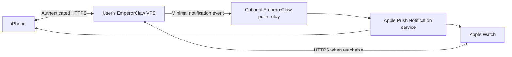

# EmperorClaw for iPhone and Apple Watch

Status: planning only; implementation has not started.
Date: 2026-11-21.
Scope: native iPhone app and Apple Watch companion for existing EmperorClaw installations, including independently hosted VPS deployments.

## 1. Product intent and agreed scope

Create one mobile product with two complementary experiences: iPhone for running the team and Apple Watch for checking in and responding quickly. Users connect their existing EmperorClaw installation; agents continue running on their server.

The apps answer three questions:

1. What is happening?
2. What needs me?
3. Can I talk to my agents?

The user specifically requested quick access to agents, conversations when they have questions, visibility into whether agents are working, a compact dashboard, tasks, and Apple Watch support planned from the beginning. The phone experience should be useful without becoming a complete reproduction of the administration website.

This document records the full proposed product, visual, connection and delivery plan. It authorizes no implementation, deployment, infrastructure provisioning or publishing by itself. The user requested documentation committed on a separate branch before switching models and beginning development later.

## 2. Existing foundations and implementation gaps

Repository inspection identified these reusable foundations:

| Foundation | Evidence | Planning implication |
| --- | --- | --- |
| Existing mobile navigation | `src/components/mobile-tab-bar.tsx`, `src/lib/navigation.ts` | Preserve Home, Inbox, Messages, Projects, Agents rather than introducing the earlier four-tab proposal. |
| Neutral theme with cyan/blue accents | `src/app/globals.css` | Adapt the current identity to native Apple controls and typography. |
| Scoped access and roles | `src/lib/roles.ts`, `src/lib/company-access.ts` | Reuse authorization rules; preserve company, client, project and agent boundaries. |
| Approval decisions and race handling | `src/app/api/approvals/[id]/route.ts` | Reuse decision semantics and server-confirmed outcomes. |
| Existing OAuth for MCP | `src/lib/oauth.ts`, `src/app/api/oauth/token/route.ts` | Useful starting point, not a complete mobile login/session system. |
| Redirect validation | `src/lib/oauth-redirect.ts` | Currently permits HTTPS and HTTP loopback, so a native callback needs explicit design and validation. |
| Notification events | `src/lib/notifications.ts` | Reuse event production; Apple push registration and delivery require new work. |
| Compact live feed and character identity | `src/lib/live-feed-v2.ts`, `devices/throne-display/README.md` | Reuse concepts and visual identity; do not couple mobile API evolution to the frozen firmware contract. |
| Existing product direction | `docs/roadmap/product-decisions.md` | Maintain emphasis on delivery visibility, scoped client work, and operating the team from a phone. |

The current web API uses browser-session guards in relevant routes. The inspected OAuth token endpoint supports authorization-code exchange, without a refresh-token grant. Native user credentials must not simply be treated as existing company-level MCP credentials. Source findings describe the planning snapshot and must be rechecked when implementation begins.

## 3. iPhone information architecture

Use five primary tabs in the current mobile-web order. Each tab retains its own navigation state. Honor enabled server modules and the user's permissions.

| Tab | Content | Primary actions |
| --- | --- | --- |
| Home | Attention summary, active agents, recent results, compact spending context | Review an issue, open an agent, ask the lead agent |
| Inbox | Approvals, blocked tasks, failures, questions needing a human | Approve, reject, answer, retry or reassign where permitted |
| Messages | Agent conversations, team threads and unread replies | Type, dictate, attach context, review attachments |
| Projects | Tasks grouped by project, simple status filters | Create, assign, comment, review progress and results |
| Agents | Searchable roster, avatars, status and current work | Chat, inspect activity, pause or resume where permitted |

The header identifies the active installation and company. A selector opens saved installations and accessible companies. Settings contains notification preferences, appearance, connection diagnostics, device sessions and sign-out. Costs remain permission-controlled.

### Home hierarchy

Home should be understandable within five seconds, in this order:

1. Needs you: the most important unresolved item and the count of remaining items.
2. Your team: a compact summary such as "6 working · 2 available · 1 blocked", then a few relevant agents.
3. Recent results: completed work with a short outcome and a deliverable link.
4. Spending: a small current-period figure and budget context, with currency, period and estimate labels where applicable.

Keep a direct shortcut to the lead agent. Existing character avatars provide continuity. An optional small team illustration can add personality, but status and actions remain understandable without animation or an office scene.

### Inbox

Separate items requiring a decision from informational updates. Badge counts represent the current user's actionable items. Show why an item needs attention, who requested it, the affected task or project, and the available next actions. Preserve stable ordering while a user reads. Reconcile changes made on another device.

For approvals, present the exact proposed action and material consequences before a decision. Fetch fresh state and permissions before executing. If already resolved, show the actual outcome rather than an optimistic success message.

### Projects and tasks

Default to a readable list with Active, Blocked and Completed filters. Project detail provides its tasks; task detail provides description, assignee, status, relevant activity, discussion and deliverables. Expose basic task creation and assignment, comments, and context-aware chat. Avoid requiring horizontal board navigation on a phone.

### Agents

Each row shows a recognizable avatar, name, role, explicit activity state, current task and freshness. Agent detail prioritizes Chat and current work, then recent activity and applicable controls. Pause/resume behavior must use the server's established semantics and explain the consequence before confirmation when needed.

## 4. Conversation and voice experience

Chat is the core mobile interaction. A user should quickly ask an agent what it is doing, why work is blocked, or how to revise a result.

Conversation requirements:

- Header with agent identity, status and current task.
- Distinct sending, server-received, awaiting-response and failed delivery states. Do not imply that server receipt means the agent has read the message.
- Streaming replies where supported, with readable formatting and reconnect recovery.
- Dictation with a visible, editable transcript before sending.
- File and image attachment access governed by existing permissions.
- Visible task/project context chips, removable before sending.
- A user-reviewed "Create task from this" action to turn discussion into trackable work.
- Preserve local drafts and avoid duplicate sends after retries.

"Ask about this" appears on tasks, failures, approvals and results. It opens the relevant conversation with a visible reference attached; the server resolves that reference within the user's access scope.

First-release voice means speech-to-text messages. Continuous spoken conversation is a later capability requiring separate decisions on provider selection, audio handling, interruption, latency and cost. Do not promise live voice in the initial scope.

## 5. Activity, freshness and disconnected behavior

Agent activity and app connectivity are separate dimensions.

| State | Meaning |
| --- | --- |
| Working | Server reports active work |
| Available | Connected with no active work |
| Waiting | Waiting for approval, input or another dependency |
| Blocked | A known problem prevents progress |
| Paused | Execution intentionally paused |
| Offline | Server reports loss of contact with the agent |
| Status unavailable | App cannot obtain fresh information |

Show a last-updated timestamp. A failed phone-to-VPS connection must not mark the entire fleet offline. Keep cached information with an explicit stale label; never silently present old state as current. Working status must derive from meaningful server activity rather than a decorative animation.

Allow reading cached, authorized content and editing drafts offline. Approvals and execution controls require a fresh authenticated server connection. Do not silently queue consequential actions for later execution. On reconnect, recover events or fetch a fresh snapshot if the event history is unavailable.

Clear connection errors distinguish no network, unreachable server, TLS failure, expired sign-in, revoked access and incompatible server version. Retry must be deliberate and bounded, with backoff.

## 6. Visual design system

Direction: calm, compact, native and recognizably EmperorClaw. Preserve the current neutral/cyan-blue identity. These are proposed native tokens inspired by the web theme, not exact conversions of its OKLCH values.

| Semantic role | Light | Dark |
| --- | --- | --- |
| Background | `#F7F8FA` | `#101114` |
| Card/surface | `#FFFFFF` | `#1B1D22` |
| Primary text | `#18181B` | `#F4F4F5` |
| Secondary text | `#52525B` | `#A1A1AA` |
| Brand/action | `#036B91` | `#59D4F5` |
| Healthy/success | `#047857` | `#34D399` |
| Waiting/attention | `#92400E` | `#FBBF24` |
| Failure/destructive | `#BE123C` | `#FB7185` |

White labels suit the dark blue light-mode primary button; dark labels suit the bright cyan dark-mode button. Validate contrast in final combinations, including disabled and pressed states. Use semantic tokens rather than per-screen colors.

Typography and layout:

- SF system typography, approximately 17-point body text, with native text styles and Dynamic Type.
- Approximately 20-point page margins, 16-point card padding and a 4/8-point spacing rhythm.
- Approximately 16-point card corners, restrained borders/elevation, and native materials where they clarify navigation hierarchy.
- Native tabs, navigation, sheets, menus, pickers and SF Symbols.
- Existing agent character identities for personality; consistent system icons for controls.
- At least 44-point iPhone touch targets, safe-area-aware layouts and visible alternatives to gestures.
- Color accompanied by text or an icon; cyan for actions, amber for attention, red for failure/destructive actions.
- System appearance by default, with explicit light/dark overrides.
- VoiceOver labels and logical reading order, larger-text layouts, reduced motion and appropriate haptics.

Use motion to explain state changes and acknowledge actions. Avoid constant status blinking and decorative animations that imply progress. Preserve scroll position when live data arrives.

## 7. Apple Watch product and UI

The watch delivers a glance followed by a brief action. It is designed alongside the phone from the foundation stage.

| Surface | Content and behavior |
| --- | --- |
| Main screen | Selected company, working count, attention count, freshness |
| Needs you | Short list of actionable approvals and human questions |
| Agent detail | Avatar, name, status, current task and Message |
| Quick message | Select agent, dictate, review and send |
| Complication | Attention count or fleet summary, opening the relevant view |
| Smart Stack widget | Relevant pending issue or compact fleet summary |

Use a black background, readable text, cyan accents and vertical controls. Support Digital Crown scrolling and shallow navigation. Start with a selected workspace and favorite agents configured on iPhone; always identify the workspace in consequential interactions.

Watch approval detail must include the requester, proposed action, target and material consequences. If sufficient context cannot be displayed clearly, offer Review on iPhone. Do not approve from a truncated notification or stale cached summary. Keep the same server permission and race handling rules as iPhone.

Handoff/deep links open the exact conversation, task or approval on iPhone with its installation and company context. Complications and widgets show minimal information and respect privacy settings; sensitive content should not be exposed in Always On or locked contexts.

### Watch connectivity

Initial setup begins on iPhone. The server issues a distinct revocable watch credential with appropriate user scope; do not copy a permanent administrator token. Watch Connectivity can assist with pairing, snapshots and handoff. Direct authenticated HTTPS lets the watch fetch and act when it can reach the server independently.

Do not depend on the iPhone being continuously available as a background network proxy. A phone's VPN does not establish that the watch has equivalent private-network access. If the watch cannot reach the server, show cached status with freshness and direct the user to iPhone for actions.

Whether to support installation and sign-in entirely without an iPhone is a later distribution decision. Direct network capability and fully independent onboarding are separate requirements.

Background execution and complication updates are system-managed. Promise fresh data when fetched and useful event-driven notifications, not a continuously live background dashboard.

## 8. Self-hosted connection architecture

Distribute one official app that connects to any compatible EmperorClaw installation. Customers do not need a custom app build or Apple developer account.

### Connection flow

1. Choose Connect EmperorClaw.
2. Scan a QR code from the web dashboard, or enter a server URL.
3. Validate reachability, server identity and mobile API capabilities.
4. Open that server's login using a system browser authentication session.
5. Sign in and authorize the device and accessible scope.
6. Exchange the authorization code using PKCE and store credentials in Keychain.
7. Select an accessible company and load the first snapshot.
8. Offer notification permission and watch pairing after successful connection.

The QR code contains connection information and a short-lived, single-use pairing reference, never a permanent privileged token. Show the server origin before sign-in. Bind state, PKCE, callback and token exchange to the selected installation; prevent cross-server login mix-ups and reject unexpected redirects. Never send credentials to an unrelated host discovered through a redirect.

Use HTTPS with a trusted certificate as the supported public-release default. Do not solve certificate errors by disabling validation. Specify supported private certificate arrangements during engineering design if needed.

| Deployment | Expected behavior |
| --- | --- |
| VPS with HTTPS domain | Direct app-to-server access |
| VPS behind standard reverse proxy | Direct access, subject to supported routes and streaming configuration |
| VPN/private-network server | Phone needs network reachability; watch reachability is tested independently |
| Local-only installation | Accessible while the device can reach the local server |
| Additional browser access gateway | Compatibility needs explicit testing and potentially an additional integration |

Document supported reverse-proxy behavior, API paths, authentication callbacks, timeouts and any streaming requirements. Capability discovery should expose only minimal non-sensitive metadata before sign-in. Avoid assuming that entering a VPS address solves network reachability.

### Multiple installations and companies

Save independent connection profiles and credentials. Partition caches, drafts, subscriptions and deep links by stable installation identity, user and company. Show the origin and friendly name in the selector. Handle server migration as an authenticated reconnection rather than silently reusing credentials at a new address.

Start with one active workspace at a time. Alerts may arrive for another saved workspace; opening one selects its explicit context. A combined cross-installation dashboard is deferred.

## 9. Notifications and optional push relay

Data and commands travel directly between the apps and the user's server. The proposed official notification path is separate:

The official app's APNs provider credentials remain under EmperorClaw control and must not be distributed to customer servers. The relay accepts authenticated installation requests, verifies device bindings, applies rate limits and sends notifications. It should require no chat text, documents or approval details by default. App content is fetched directly from the source server after opening.

Before implementation, specify installation enrollment, device registration proof, credential rotation, abuse prevention, payload limits, retry policy, metadata retention and revocation. The relay must not become an arbitrary URL fetcher or accept notifications for unrelated device registrations.

Default alerts: pending approvals, direct human questions and significant failures. Routine completions are opt-in or grouped. Deduplicate by event, avoid duplicate phone/watch alerting where possible, and respect quiet hours and system notification settings. Notification delivery is best effort; the server inbox remains authoritative.

The relay does not provide remote access to a private VPS. A notification can arrive while opening details still requires a VPN. A future optional connection tunnel is a separate service, with separate privacy, security, cost and operations decisions.

Relay use is optional. Without it, foreground/direct app access remains available when the server is reachable, but background notifications are reduced. If the relay is unavailable, core direct communication continues. A failed VPS cannot reliably report its own outage; external uptime monitoring is outside this initial plan.

## 10. Shared technical foundation

Use SwiftUI for iPhone and watchOS with shared models, networking and authentication components where appropriate. Keep platform-specific navigation and presentation distinct. Agents remain server-side. No provider selection or infrastructure provisioning is part of this planning commit.

Backend requirements:

- Versioned mobile API and capability discovery, with a documented compatibility policy.
- Human-user identity, short-lived access tokens, rotating refresh tokens and individual device revocation.
- Native OAuth callback support with exact approved redirects, PKCE and state validation.
- Authorization through existing business rules on every request, including permissions changed after login.
- Explicit installation/company identity in requests, cached records and deep links.
- Foreground event updates, reconnect cursors and snapshot recovery; choose the transport after auditing existing realtime delivery.
- Idempotency for messages, task creation and commands, with server acknowledgements.
- Approval conflict handling and audit attribution to the actual user/device.
- Push registration, preferences, deduplication and token lifecycle handling.
- Compact watch snapshots derived from the same authorized state as the phone.

Do not freeze endpoint names or reuse the firmware API without an API audit. Inventory existing routes and extract shared services instead of duplicating authorization and business logic in a parallel mobile backend.

Compatibility requirements:

- Discover supported features and minimum compatible API versions before showing actions.
- Hide unavailable features with understandable explanations when needed.
- Give precise upgrade guidance for incompatible servers.
- Test the documented server compatibility range; define that range before beta.
- Reconcile events and counters across phone, watch and web.
- Clear or invalidate affected cached content when signing out, switching identities or discovering revoked access.

## 11. Scope boundaries

Initial release includes connection management, fleet visibility, inbox, contextual chat, dictation, basic task workflows, results/attachments, permitted agent controls, scoped spending summary, push, watch glance/actions and handoff.

Defer advanced runtime provisioning, secret/provider configuration, complex automation editing, full organization-chart editing, continuous voice conversations, a cross-server aggregate dashboard, custom wearable hardware and a hosted connection tunnel. Existing web pages remain the route to advanced administration.

## 12. Delivery sequence

| Stage | Deliverables | Exit criteria |
| --- | --- | --- |
| 1. Design and connection validation | Screen flows, light/dark layouts, API inventory, authentication and reachability proof | Connect to separate installations; prove permission mapping; settle callback, private-network and push assumptions |
| 2. Shared foundation | Mobile API, tokens, devices, compatibility, diagnostics and event recovery | Revocation and tenant isolation work; retries do not duplicate commands; unsupported servers fail clearly |
| 3. iPhone beta | Five tabs, chat/dictation, tasks, approvals, results and notifications | Core workflows complete on real devices and poor networks with accurate delivery states |
| 4. Watch beta | Snapshot, attention list, quick messages, appropriate decisions, complication/widget and handoff | Direct reachability and offline limits are clear; actions confirm server outcomes |
| 5. Release preparation | Accessibility, privacy review, compatibility matrix, onboarding documentation and App Store preparation | Release validation passes; support and relay operations are defined |

Watch requirements inform API and notification work from stage 1 even though the iPhone beta is delivered first. Publishing and infrastructure operations require a later execution scope.

Earlier discussion offered rough estimates: 2–3 weeks for an iPhone prototype, 6–10 weeks total for a useful iPhone beta, another 2–4 weeks for a focused watch companion, and approximately 3–5 months total for a polished release. These assumed an experienced Apple developer with backend support and are not commitments. Re-estimate after stage 1, especially authentication, gateway compatibility and relay operations.

## 13. Validation and acceptance criteria

Product acceptance:

- A user connects a compatible installation without copying a long-lived API secret.
- Fleet activity is understandable within five seconds.
- An agent conversation is reachable within two taps from relevant main screens.
- A blocked task explains its reason and offers an applicable next step.
- Every successful consequential action has a server acknowledgement.
- Switching installations never mixes data, drafts, notifications or credentials.
- Watch interactions remain brief and useful without routine notification overload.

Required validation scenarios for later implementation:

- At least two independent VPS installations and multiple user scopes/companies.
- HTTPS domain, standard reverse proxy, private network, unreachable host and invalid certificate.
- Expired and revoked tokens, changed permissions and removed company access.
- Old server capabilities and unsupported API versions.
- Network loss during send, duplicate retry, reconnect gaps and stale snapshots.
- An approval decided on web while open on phone/watch.
- Watch with phone nearby, phone unavailable, direct internet access and no private-server route.
- Relay unavailable, disabled notifications, duplicate/out-of-order events and private previews.
- Small and large iPhones, supported watch sizes, large Dynamic Type, VoiceOver and reduced motion.
- Battery/network behavior under normal foreground and background use.

Do not write implementation tests as part of this documentation-only task. These are future release checks.

## 14. Decisions to resolve during the first implementation stage

1. Minimum supported iOS/watchOS versions and tested device matrix.
2. Mobile API version policy and minimum compatible EmperorClaw release.
3. Native OAuth callback strategy and mobile token storage/rotation schema.
4. Foreground event transport and reconnect protocol.
5. Official push-relay enrollment, retention, operational ownership and costs.
6. Supported private networks and third-party access gateways.
7. Initial attachment formats and size limits based on current server support.
8. Final state mapping from server activity/health to mobile labels.
9. Watch standalone onboarding scope, distinct from direct server networking.

These decisions should be settled with source inspection and small connection proofs before broad screen implementation. Reuse the choices already made in this plan unless evidence warrants an explicit revision.

## 15. Official Apple references

- [Designing for watchOS](https://developer.apple.com/design/human-interface-guidelines/designing-for-watchos): brief, focused interactions and shallow navigation.
- [watchOS apps](https://developer.apple.com/documentation/watchos-apps): independent apps, authentication and content updates.
- [Background execution](https://developer.apple.com/documentation/watchkit/background-execution): system-managed background work.
- [WidgetKit](https://developer.apple.com/documentation/widgetkit/): widgets and watch complications.
- [Authenticating a user through a web service](https://developer.apple.com/documentation/authenticationservices/authenticating-a-user-through-a-web-service): system browser authentication sessions.
- [Setting up a remote notification server](https://developer.apple.com/documentation/usernotifications/setting-up-a-remote-notification-server): provider authentication and APNs connections.

Recheck platform guidance when implementation begins. Proposed product behavior and estimates in this document are planning decisions, not claims that those features already exist.
